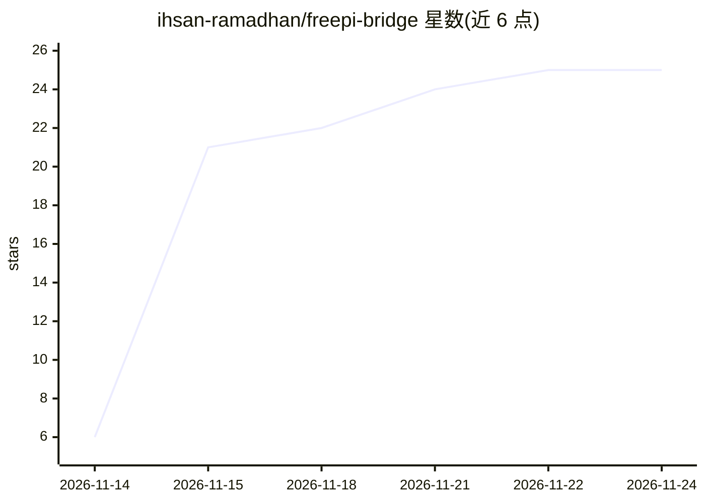

# ihsan-ramadhan/freepi-bridge

⭐ 25 · Rust · NOASSERTION · 推送 2026-11-22 · [GitHub](https://github.com/ihsan-ramadhan/freepi-bridge) · 个人维护 · 中文 README

**把 FreePi 账号转成 OpenAI 兼容 API 的单二进制 Rust 网关**

用 Rust 编写的自托管 HTTP 网关：把 OpenAI 兼容的 /v1/chat/completions（含 SSE 流式）与 /v1/models 请求转发到 api.freepi.ai，使 opencode、pi、omp 等 OpenAI 兼容应用可直接使用 FreePi 账号额度。单静态二进制分发，无需运行时；负责处理 FreePi 的 GitHub 登录 JWT 令牌、每 10 分钟自动上报广告曝光、单账号单并发排队（可配等待时长后返回 429）。提供 CLI 命令（start/doctor/usage 等）、Docker 镜像与配置文件。限制：依赖 FreePi 账号与配额，非循环绑定需设置 API key。

## 筛选速览

| 维度 | 判定 | 备注 |
|---|---|---|
| AI 角色 | `ai-ecosystem` | LLM/agent 周边工具 |
| 许可风险 | `viral` | NOASSERTION |
| 部署形态 | `desktop` | 安装包/桌面程序 |
| 模型依赖 | — | README 未给出锁定关系 |
| 硬件要求 | — | 无带数字的原话,不猜 |
| 安装摩擦 | `low` | 无编译、无系统依赖或容器化 |
| 成熟度 | — | 结构信号不足 |

## 能力要点

- OpenAI 兼容端点转发至 api.freepi.ai，支持 SSE 流式
- 无广告浏览器环境下每 10 分钟自动上报广告曝光（FREEPI_AUTO_AD）
- 单账号单并发槽位排队与 Retry-After 处理
- 单二进制安装脚本覆盖 Linux/macOS/Windows，另有 Docker 与 docker compose

## 适用场景

- 让 opencode 等 OpenAI 兼容应用使用我的 FreePi 免费额度
- 在无浏览器服务器上通过 FREEPI_TOKEN 运行 FreePi 网关
- 用 Docker 自托管并限制访问 key

## 场景标签

`模型网关` · 领域:Agent 开发

## 证据(README 行号)

> L3: **An OpenAI-compatible HTTP API for a FreePi account.**
> L13: completions work. The bridge handles both and forwards requests to
> L14: `api.freepi.ai`, so any OpenAI-compatible app (opencode, pi, omp, 9router, etc) can use your FreePi account.

## 星数曲线

2026-11-14 6 → 2026-11-24 25（+19）

---
*卡片 v1 · prompt 1.4 · 生成 2026-11-18 · 置信度 mid · 依据 README sha `ce8cabe4fd0a` · [字段定义](../../DATASET.md)*
