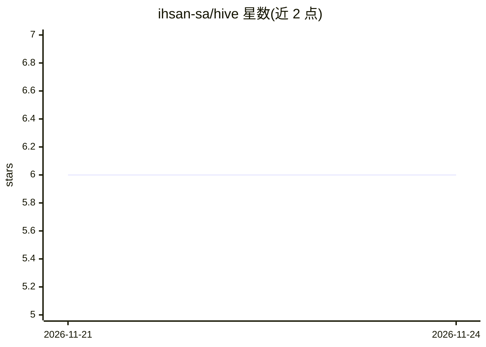

# ihsan-sa/hive

⭐ 6 · JavaScript · MIT · 推送 2026-11-22 · [GitHub](https://github.com/ihsan-sa/hive) · [官网](https://hivelab.ca) · 组织维护

**在你的机器上自托管的多 agent 协作系统，持续推进你的项目**

在一台常开的机器上运行一组共享沙箱、知识库与目标的 Claude Code/Codex agent：用户用自然语言下达任务，agent 相互启动、分工、在共享会话中交流，产出报告/代码/图表并附验证说明。任务以 focus 卡片形式组织，支持中途插话、停滞任务自动捡起、用量限制等待续跑；agent 还可按需为 Hive 自身开发新工具或功能。安装后提供 Web 应用与 hive CLI，需常开机器且消耗订阅/API 用量，作者明确提示输出需人工复核。

## 筛选速览

| 维度 | 判定 | 备注 |
|---|---|---|
| AI 角色 | `ai-ecosystem` | LLM/agent 周边工具 |
| 许可风险 | `permissive` | MIT |
| 部署形态 | `None` |  |
| 模型依赖 | — | README 未给出锁定关系 |
| 硬件要求 | — | 无带数字的原话,不猜 |
| 安装摩擦 | `low` | 无编译、无系统依赖或容器化 |
| 成熟度 | — | 结构信号不足 |

## 能力要点

- 多 agent 共享沙箱、知识库与共享会话，跨项目持续推进任务
- agent 可为 Hive 自身开发、测试并保留新功能
- 提供 Web 应用（Chat/Knowledge/Agents/Usage/Settings）与 hive CLI
- 沙箱隔离运行，支持 Linux 安装脚本、WSL 2 与无管理员权限模式

## 适用场景

- 夜间让 agent 持续推进个人项目并早晨查看进展报告
- 让多个 agent 分工协作完成需要多工具的任务
- 需要任务在用量限制后自动恢复的长时自动化工作流

## 场景标签

`多智能体` `编码 Agent` `工作流自动化` · 领域:Agent 开发

## 证据(README 行号)

> L22: A group of agents on one machine of yours, running the official Claude Code or Codex program under your own login, 
> L24: - **Not a harness.** Claude Code and Codex are harnesses: one agent in one session, which you start, steer and watc
> L81: **What it runs on:** Claude Code with your Claude subscription, Codex with your ChatGPT subscription, or an API key

## 星数曲线

2026-11-21 6 → 2026-11-24 6（+0）

---
*卡片 v1 · prompt 1.4 · 生成 2026-11-21 · 置信度 high · 依据 README sha `be979b1cb352` · [字段定义](../../DATASET.md)*
