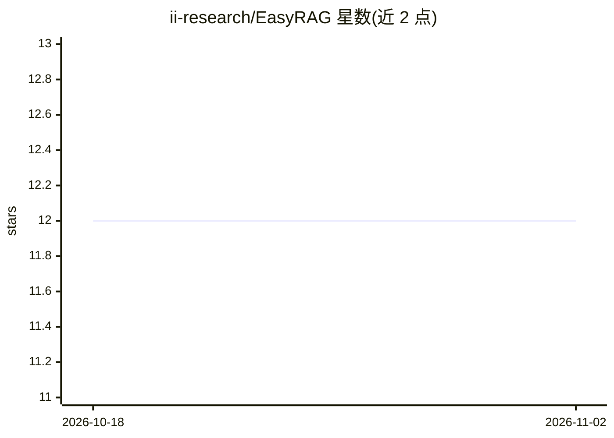

# ii-research/EasyRAG

⭐ 12 · Python · MIT · 推送 2026-07-15 · [GitHub](https://github.com/ii-research/EasyRAG) · [官网](https://dl.acm.org/doi/10.1145/3805712.3808385) · 组织维护

**面向初学者的交互式 RAG 框架：5 种算法实现加训练评测面板**

开源 RAG 研究框架，统一实现 LLM-Only、Naive RAG、FiD、FiD-Light、Stochastic RAG 五种算法，其中 FiD-Light 与 Stochastic RAG 为论文作者声称的首个公开实现。提供 NiceGUI 交互式 Web 面板管理 7 步模块化流水线（数据下载、索引构建、检索器训练、预计算、模型训练、评测），支持 T5-Base 与 T5Gemma2 双骨干、KILT 基准评测，以及免数据下载的 DuckDuckGo 实时演示。需 CUDA NVIDIA GPU（T5-Base 需 8GB+ 显存）。

## 筛选速览

| 维度 | 判定 | 备注 |
|---|---|---|
| AI 角色 | `ai-ecosystem` | LLM/agent 周边工具 |
| 许可风险 | `permissive` | MIT |
| 部署形态 | `None` |  |
| 模型依赖 | — | README 未给出锁定关系 |
| 硬件要求 | — | 无带数字的原话,不猜 |
| 安装摩擦 | `medium` | 含编译或系统依赖之一 |
| 成熟度 | — | 结构信号不足 |

## 能力要点

- 五种 RAG 算法统一代码库，含 FiD-Light 与 Stochastic RAG 公开实现
- NiceGUI Web 面板：训练监控、推理、模型对比、快速原型
- 7 步模块化流水线，各步独立运行与断点续训
- KILT 基准评测（NQ/TriviaQA/HotpotQA，EM/F1/KILT-EM/KILT-F1）

## 适用场景

- 学习和复现 RAG 论文算法的科研人员
- 在同一框架下训练并对比多种 RAG 方法
- 免下载数据快速演示 RAG 效果

## 场景标签

`RAG` `模型训练` `模型评测` `教程课程` · 领域:评测与运维

## 证据(README 行号)

> L8: **EasyRAG** is an open-source framework providing faithful implementations of five RAG algorithms — from simple base
> L20: - **Modular 7-Step Pipeline** — From data download to evaluation, each step independently runnable and resumable

## 星数曲线

2026-10-18 12 → 2026-11-02 12（+0）

---
*卡片 v1 · prompt 1.4 · 生成 2026-11-01 · 置信度 high · 依据 README sha `5f47c4eb13c2` · [字段定义](../../DATASET.md)*
