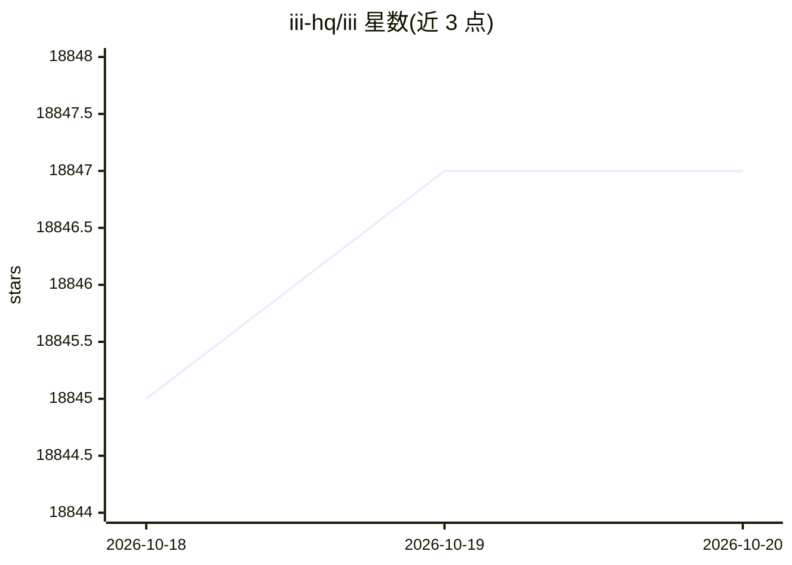

# iii-hq/iii

⭐ 18,847 · Rust · 推送 2026-10-19 · [GitHub](https://github.com/iii-hq/iii) · [官网](https://iii.dev) · 组织维护

**实时组合与观测后端服务的共享运行时引擎**

iii 是一个用 Rust 编写的引擎与共享运行时，将后端服务抽象为三个原语：Workers（注册到引擎的进程，支持 TypeScript/Python/Rust/Go SDK）、Triggers（HTTP、cron、队列、状态变更等触发方式）和 Functions（带稳定标识的工作单元）。通过 worker-compose.yaml 或运行时命令组合服务，所有 worker 进入实时目录并可互相调用，agent 可用与开发者相同的接口发现、调用和扩展能力。附带 Agent Skills（可安装到第三方 harness）、开发者控制台与 Docker 镜像。

## 筛选速览

| 维度 | 判定 | 备注 |
|---|---|---|
| AI 角色 | `ai-ecosystem` | LLM/agent 周边工具 |
| 许可风险 | `none` | — |
| 部署形态 | `self-host` | docker 或自建部署 |
| 模型依赖 | — | README 未给出锁定关系 |
| 硬件要求 | — | 无带数字的原话,不猜 |
| 安装摩擦 | `low` | 无编译、无系统依赖或容器化 |
| 成熟度 | — | 结构信号不足 |

## 动量与使用信号

- 维护:`active` — 距上次 push 0.8 天,年发版 100,54 位贡献者
- 涨星:近 1 天 **+3**(自 20261016 起算)
- 安装:npm 包 `iii-sdk` 月下载 153,107

## 能力要点

- Workers/Triggers/Functions 三原语统一队列、cron、HTTP、状态与观测
- 运行时动态添加 worker，agent 用同一目录与调用接口扩展系统
- Node.js/Python/Rust/Go 四语言 SDK
- 提供开发者控制台与可装到第三方 harness 的 Agent Skills

## 适用场景

- 用统一运行时替代多种后端集成工具
- 让 agent 在运行中发现并调用系统能力、按需添加 worker
- 通过控制台查看 worker、触发器、队列与调用链路

## 场景标签

`工作流自动化` · 领域:效率与自动化

## 证据(README 行号)

> L30: iii is the easiest way to compose, observe, discover, extend, and react (CODER) to every service in
> L47: That is the agent story too: when a task needs a capability the system does not have, an agent can

## 星数曲线

2026-10-18 18,845 → 2026-10-20 18,847（+2）

---
*卡片 v1 · prompt 1.4 · 生成 2026-10-20 · 置信度 mid · 依据 README sha `4c72230aaac6` · [字段定义](../../DATASET.md)*
