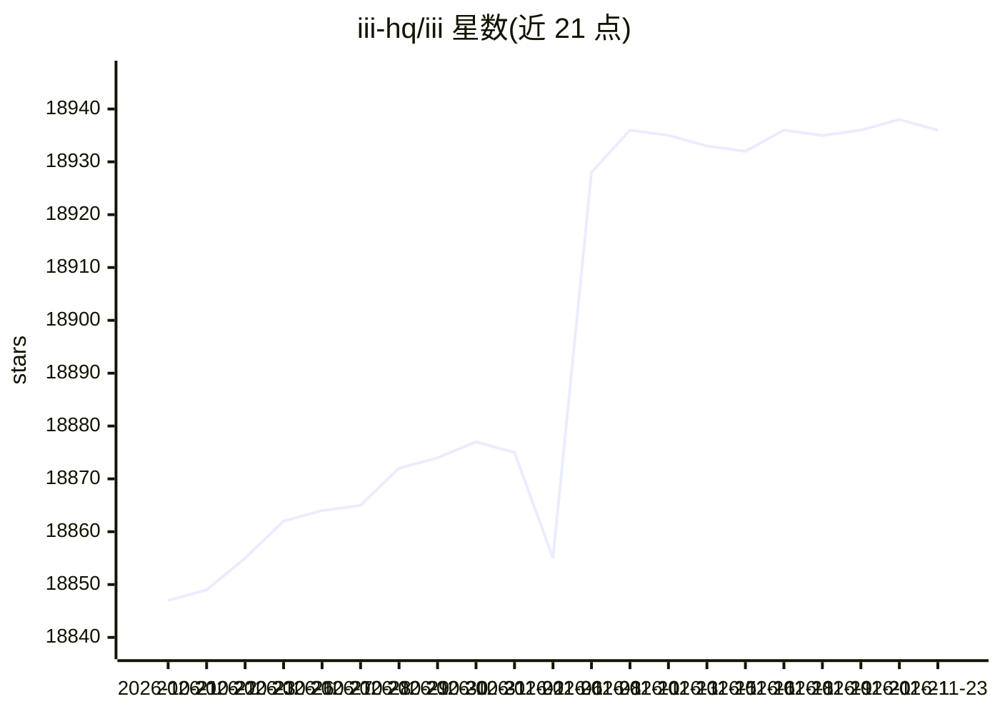

# iii-hq/iii

⭐ 18,936 · Rust · 推送 2026-11-22 · [GitHub](https://github.com/iii-hq/iii) · [官网](https://iii.dev) · 组织维护 · 中文 README

**开发者用函数引擎：把服务、agent、API 组合为可调用系统**

iii 以 Function 为唯一原语的引擎，用 worker.call 与 worker.observe 两个操作符统一队列、数据库、HTTP、流式、沙箱、agent 等能力；各语言 worker 以 SDK 接入同一引擎，跨语言跨机器互调与观察，引擎维护实时 Function 注册表供开发者与 agent 发现，提供 OTLP 导出的全链路追踪。Compose 文件定义 worker，可一键启停/升级整个服务栈。提供 Rust 引擎与 CLI，TypeScript/Python/Rust/Go 四种 SDK，安装脚本可选交互或非交互模式；引擎部分采用 Elastic License 2.0。

## 筛选速览

| 维度 | 判定 | 备注 |
|---|---|---|
| AI 角色 | `ai-ecosystem` | LLM/agent 周边工具 |
| 许可风险 | `none` | — |
| 部署形态 | `self-host` | docker 或自建部署 |
| 模型依赖 | — | README 未给出锁定关系 |
| 硬件要求 | — | 无带数字的原话,不猜 |
| 安装摩擦 | `low` | 无编译、无系统依赖或容器化 |
| 成熟度 | — | 结构信号不足 |

## 动量与使用信号

- 维护:`active` — 距上次 push 0.8 天,年发版 100,54 位贡献者
- 涨星:近 1 天 **+3**(自 20261016 起算)
- 安装:npm 包 `iii-sdk` 月下载 153,107

## 能力要点

- 单原语 Function + call/observe 两操作符统一服务集成
- 引擎维护实时 Function 注册表，agent 与开发者可发现
- 跨语言 SDK（TypeScript/Python/Rust/Go）接入同一 API
- Compose 文件定义 worker，一条命令启停/升级服务栈

## 适用场景

- 把多语言微服务与工具函数接入统一引擎互相调用
- 让编码 agent 通过注册表发现并调用系统内函数
- 为分布式服务栈提供统一追踪与事件响应机制

## 场景标签

`Agent 框架` · 领域:Agent 开发

## 证据(README 行号)

> L35: iii removes that work with one primitive, the **Function**. Services, agents, and tools connect to one engine as wo
> L63: |**D**|Discoverability|The engine holds a live registry of every Function. It's always up to date so developers and
> L125: |`skills/`|Agent skills for coding agents|

## 星数曲线

2026-10-21 18,847 → 2026-11-23 18,936（+89）

---
*卡片 v1 · prompt 1.4 · 生成 2026-11-22 · 置信度 mid · 依据 README sha `12816f9180a3` · [字段定义](../../DATASET.md)*
