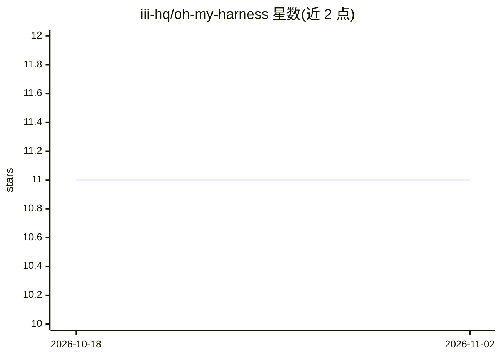

# iii-hq/oh-my-harness

⭐ 11 · Apache-2.0 · 推送 2026-07-30 · [GitHub](https://github.com/iii-hq/oh-my-harness) · [官网](https://workers.iii.dev) · 组织维护

**基于 iii 引擎的可组装 agent 回合循环与控制台**

运行在 iii 引擎（WebSocket 路由的 worker mesh）之上的两个 worker：harness 负责持久化回合循环——接收消息、持久化、组装上下文、流式生成、执行模型请求的函数调用并循环至回合结束，每步可崩溃恢复；console 提供 React UI 与引擎 WebSocket 同端口，可检查函数、观察触发器。自带 session/context/llm-router/队列等一整套 worker，支持 Anthropic/OpenAI/xAI/Moonshot/Z.AI 及本地 llama.cpp provider，函数调用默认拒绝、可加人工审批门、五个同步 hook 点与回合事件绑定。通过 iii CLI 安装，配 key 后使用。

## 筛选速览

| 维度 | 判定 | 备注 |
|---|---|---|
| AI 角色 | `ai-ecosystem` | LLM/agent 周边工具 |
| 许可风险 | `permissive` | Apache-2.0 |
| 部署形态 | `None` |  |
| 模型依赖 | local-ok | 支持本地模型 |
| 硬件要求 | — | 无带数字的原话,不猜 |
| 安装摩擦 | `low` | 无编译、无系统依赖或容器化 |
| 成熟度 | — | 结构信号不足 |

## 能力要点

- 持久化回合循环，崩溃或重启后回合可续
- 函数调用默认拒绝，可按发送配置 allow 并加 approval-gate 人工审批
- 五个同步 hook 点（pre-turn/post-generate 等）可否决回合、改写参数与结果
- provider 均为可插拔 worker，支持本地 llama.cpp（含本地 embeddings）

## 适用场景

- 想组装而非 fork 框架地搭建自己的 agent 循环
- 用个人 ChatGPT/Codex 订阅驱动 agent 生成
- 在浏览器中观察与操控 agent 部署、trace 与触发器

## 场景标签

`Agent 框架` `Agent 记忆` · 领域:Agent 开发

## 证据(README 行号)

> L20: `harness` runs the durable turn loop that keeps your agents moving: it takes an
> L22: the function calls the model asks for, and repeats until the turn stops. Every
> L86: Anthropic and OpenAI ship with the harness. Every other provider is one worker

## 星数曲线

2026-10-18 11 → 2026-11-02 11（+0）

---
*卡片 v1 · prompt 1.4 · 生成 2026-11-02 · 置信度 high · 依据 README sha `6414bfc4a3a1` · [字段定义](../../DATASET.md)*
