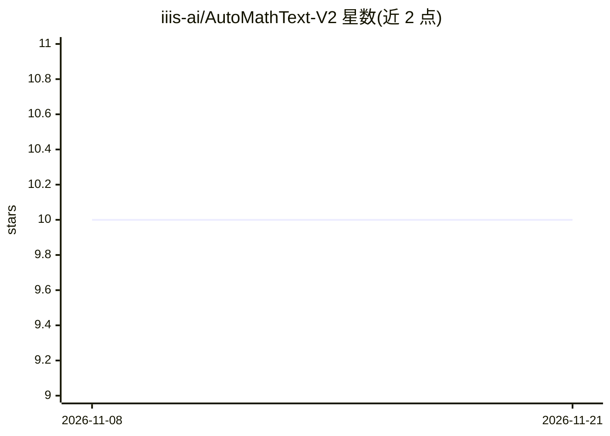

# iiis-ai/AutoMathText-V2

⭐ 10 · HTML · NOASSERTION · 推送 2026-03-23 · [GitHub](https://github.com/iiis-ai/AutoMathText-V2) · [官网](https://iiis-ai.github.io/AutoMathText-V2) · 组织维护

**面向 LLM 预训练的 2.46 万亿 token STEM 语料数据集**

一个由 AI 流程策划的 STEM 预训练数据集，共 2.46 万亿 token，覆盖网页、数学、代码、推理与中英双语内容，整合 52 个 HuggingFace 数据源。制作流程包含三层去重（精确 SHA256、MinHash+LSH 模糊、GTE 嵌入语义）、基于 Qwen2 分类器的质量评分与多源分数融合、LaTeX/代码保护的文本清洗，以及针对 GSM8K 等测试集的污染检测过滤。使用时通过 HuggingFace datasets 库加载，支持按领域与质量分位配置；RefineCode 域仅含元数据，需 AWS 凭证从 S3 下载代码内容。

## 筛选速览

| 维度 | 判定 | 备注 |
|---|---|---|
| AI 角色 | `ai-knowledge` | 知识聚合/清单类 |
| 许可风险 | `none` | NOASSERTION |
| 部署形态 | `library` | 以包/库形式分发 |
| 模型依赖 | — | README 未给出锁定关系 |
| 硬件要求 | — | 无带数字的原话,不猜 |
| 安装摩擦 | `low` | 无编译、无系统依赖或容器化 |
| 成熟度 | — | 结构信号不足 |

## 能力要点

- 三层去重流程：精确哈希、MinHash+LSH 模糊去重、GTE 嵌入语义去重
- 基于 Qwen2 的质量分类器与多源分数融合，按 10 个质量分位划分 token
- 52 个数据源均附官方 HuggingFace 数据集链接
- 测试集污染检测：自动过滤 GSM8K 等评测题泄漏

## 适用场景

- 为大语言模型预训练获取大规模 STEM 语料
- 按质量分位或领域配置采样训练数据
- 筛选中英双语教育内容用于训练

## 场景标签

 · 领域:NLP/训练数据集

## 证据(README 行号)

> L9: 📊 **AutoMathText-V2** consists of **2.46 trillion tokens** of high-quality, deduplicated text spanning web content, 
> L16: - **🔍 Triple Deduplication**: Exact → Fuzzy (MinHash+LSH) → Semantic (GTE embeddings)
> L17: - **🤖 AI Quality Assessment**: Qwen2-based classifier with multi-source score fusion

## 星数曲线

2026-11-08 10 → 2026-11-21 10（+0）

---
*卡片 v1 · prompt 1.4 · 生成 2026-11-19 · 置信度 mid · 依据 README sha `de2e65e2909d` · [字段定义](../../DATASET.md)*
