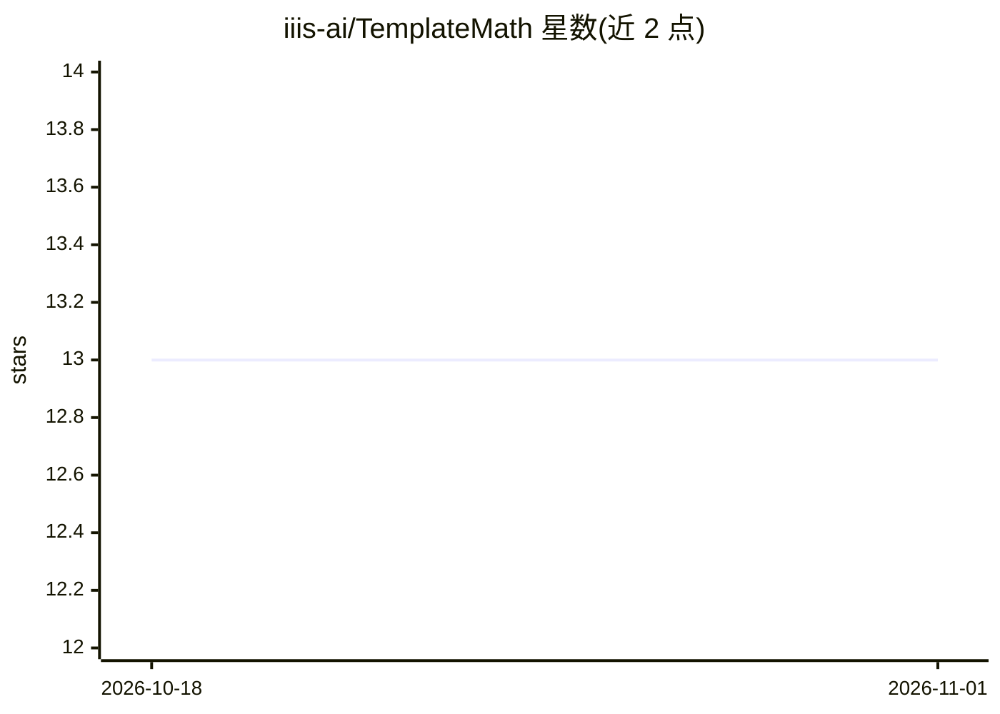

# iiis-ai/TemplateMath

⭐ 13 · Python · 推送 2026-05-13 · [GitHub](https://github.com/iiis-ai/TemplateMath) · [官网](https://templatemath.github.io) · 组织维护

**740 万题的程序化验证数学数据集 TemplateGSM 及 TDG 生成范式**

ICLR 2025 DATA-FM Workshop 论文的官方仓库，提出 Template-based Data Generation (TDG) 数据生成范式，并据此发布 TemplateGSM 数据集：740 余万个合成小学数学题，每题附带自然语言分步解答、可执行的 Python 代码解答与最终数值答案，所有解答均经程序运行验证。题目由 GPT-4 撰写的 7,473 个元模板生成，按模板数量分为 100 万至 747 万的四种配置，托管于 Hugging Face Hub，通过 datasets 库加载。数据结构支持监督微调与可验证奖励强化学习 (RLVR)。面向 LLM 训练研究者，Python 3.10+。

## 筛选速览

| 维度 | 判定 | 备注 |
|---|---|---|
| AI 角色 | `ai-knowledge` | 知识聚合/清单类 |
| 许可风险 | `none` | — |
| 部署形态 | `None` |  |
| 模型依赖 | — | README 未给出锁定关系 |
| 硬件要求 | — | 无带数字的原话,不猜 |
| 安装摩擦 | `low` | 无编译、无系统依赖或容器化 |
| 成熟度 | — | 结构信号不足 |

## 能力要点

- 740 万+ 题目-解答对，每个解答均经程序化执行验证
- 由 7,473 个 GPT-4 撰写的元模板生成，可扩展生成更多
- 每条含 problem、代码解答、自然语言解答、result 等字段
- 提供 100 万/200 万/400 万/747 万四种规模配置

## 适用场景

- 为数学推理任务的监督微调 (SFT) 提供训练数据
- 用正确/错误的二元奖励信号做 RLVR 强化学习训练
- 评测语言模型的数学推理能力

## 场景标签

`微调` `强化学习` · 领域:训练与推理

## 证据(README 行号)

> L11: Our work introduces **Template-based Data Generation (TDG)**, a scalable paradigm to address the critical data bott
> L15: **TemplateGSM** is a foundational dataset containing **over 7.4 million** grade school math problems. Each problem 

## 星数曲线

2026-10-18 13 → 2026-11-01 13（+0）

---
*卡片 v1 · prompt 1.4 · 生成 2026-10-31 · 置信度 high · 依据 README sha `dcfe498b4a3f` · [字段定义](../../DATASET.md)*
