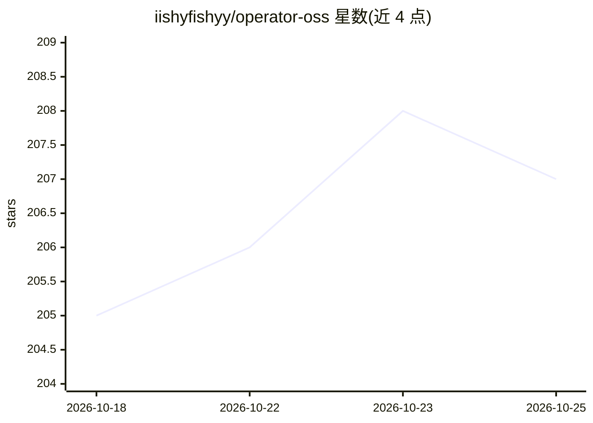

# iishyfishyy/operator-oss

⭐ 207 · TypeScript · Apache-2.0 · 推送 2026-10-22 · [GitHub](https://github.com/iishyfishyy/operator-oss) · [官网](https://getoperator.dev) · 个人维护

**网页端并行编排 Claude Code/Codex 会话的控制台**

面向开发者的编码 agent 编排 Web 应用：每个任务在独立 git worktree 中运行持久的 Claude Code 或 Codex 会话，支持跨项目并行、任务依赖链与自动启动、统一待办收件箱、diff 审查与分支合并。提供本地运行、自托管与托管三种模式，数据留在本机。支持订阅登录无需 API key，包含模型选择（含 Bedrock inference-profile ID）、Codex 权限模式配置与提示词检查器。需 Node 20.9+ 与至少一个受支持的 agent CLI。

## 筛选速览

| 维度 | 判定 | 备注 |
|---|---|---|
| AI 角色 | `ai-ecosystem` | LLM/agent 周边工具 |
| 许可风险 | `permissive` | Apache-2.0 |
| 部署形态 | `self-host` | docker 或自建部署 |
| 模型依赖 | locked-api |  |
| 硬件要求 | — | 无带数字的原话,不猜 |
| 安装摩擦 | `low` | 无编译、无系统依赖或容器化 |
| 成熟度 | — | 结构信号不足 |

## 能力要点

- 每任务独立 git worktree、分支与会话记录
- 任务依赖链与依赖完成后的自动启动
- 跨项目收件箱汇总等待输入的会话
- 订阅登录无需 API key，可选模型版本与路由 ID

## 适用场景

- 同时给多个项目派发编码 agent 任务并集中审查
- 把任务连成有依赖关系的流水线自动接力
- 在手机或平板浏览器上查看和响应 agent 会话

## 场景标签

`编码 Agent` `多智能体` · 领域:Agent 开发

## 证据(README 行号)

> L7: Operator is a web-based control room for coding agents. Every task gets a persistent agent
> L25: - **Run tasks in parallel.** Each task has its own worktree, branch, transcript, and Claude
> L75: Open <http://localhost:3000>. The first-run wizard connects Claude Code or Codex and guides

## 星数曲线

2026-10-18 205 → 2026-10-25 207（+2）

---
*卡片 v1 · prompt 1.4 · 生成 2026-10-22 · 置信度 mid · 依据 README sha `2b8e0f0070d0` · [字段定义](../../DATASET.md)*
