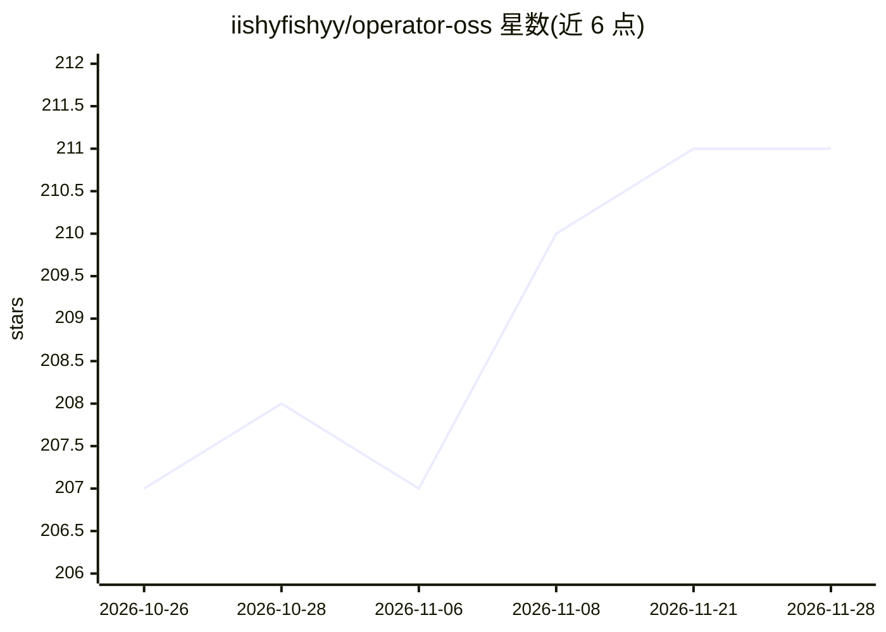

# iishyfishyy/operator-oss

⭐ 211 · TypeScript · Apache-2.0 · 推送 2026-11-26 · [GitHub](https://github.com/iishyfishyy/operator-oss) · [官网](https://getoperator.dev) · 个人维护

**一个网页控制台，并行管理多项目 Claude Code/Codex 会话**

Operator 是基于 Web 的编码 agent 编排工作台：每个任务在隔离的 git worktree 中获得独立的 Claude Code 或 Codex 会话，支持跨项目收件箱、依赖链式流水线（依赖完成后自动启动）、diff 审查与合并、自定义 slash 命令、终端与 token 用量统计。需 Node 20.9+、macOS/Linux 及至少一个 agent CLI；agent 支持订阅登录，API key 为可选。提供本地运行、自托管与托管三种模式，ORCH_DEBUG_PROMPTS=1 可检查发送给 agent 的输入快照。

## 筛选速览

| 维度 | 判定 | 备注 |
|---|---|---|
| AI 角色 | `ai-ecosystem` | LLM/agent 周边工具 |
| 许可风险 | `permissive` | Apache-2.0 |
| 部署形态 | `self-host` | docker 或自建部署 |
| 模型依赖 | — | README 未给出锁定关系 |
| 硬件要求 | — | 无带数字的原话,不猜 |
| 安装摩擦 | `low` | 无编译、无系统依赖或容器化 |
| 成熟度 | — | 结构信号不足 |

## 能力要点

- 每任务独立 git worktree、分支与会话，跨项目并行运行
- 任务依赖链流水线，解除阻塞后自动启动
- 内置 PROMPTS 检查器可查看发给 Claude Code/Codex 的输入快照
- Codex 权限模式可选（Auto-run/Plan/Full access 显式授权）

## 适用场景

- 在多个项目上同时委派编码任务并在一个界面审查合并
- 把有依赖关系的任务串成并行分支的流水线
- 在平板或手机上通过自托管工作台查看 agent 进度

## 场景标签

`编码 Agent` `多智能体` · 领域:Agent 开发

## 证据(README 行号)

> L7: Operator is a web-based control room for coding agents. Every task gets a persistent agent
> L76: you through a small real task. Both agents support subscription login, so an API key is not
> L107: captures to inspect the exact text Operator handed to Claude Code or Codex.

## 星数曲线

2026-10-26 207 → 2026-11-28 211（+4）

---
*卡片 v1 · prompt 1.4 · 生成 2026-11-25 · 置信度 mid · 依据 README sha `500863ccbf25` · [字段定义](../../DATASET.md)*
