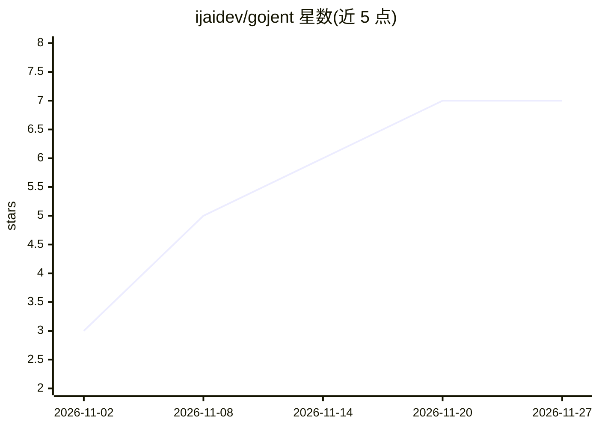

# ijaidev/gojent

⭐ 7 · Go · Apache-2.0 · 推送 2026-11-26 · [GitHub](https://github.com/ijaidev/gojent) · 个人维护

**Go 开发者的强类型 agent 运行时库**

面向 Go 开发者的 agent 运行时库，核心由 agent、llm、tool、session 四个包组成，根模块无第三方依赖。提供单一流式优先的执行循环、基于 Go 类型的工具定义（自动生成并校验 JSON Schema）、provider 无关的消息模型，以及仅含 Load/Append 两个方法的持久化契约。OpenAI、Anthropic、Gemini 适配器与 SQLite/PostgreSQL 存储以独立模块提供；附带的 codjent 示例编码 agent 仅为参考实现，无认证与部署方案。要求 Go 1.25.5 及以上。

## 筛选速览

| 维度 | 判定 | 备注 |
|---|---|---|
| AI 角色 | `ai-ecosystem` | LLM/agent 周边工具 |
| 许可风险 | `permissive` | Apache-2.0 |
| 部署形态 | `library` | 以包/库形式分发 |
| 模型依赖 | — | README 未给出锁定关系 |
| 硬件要求 | — | 无带数字的原话,不猜 |
| 安装摩擦 | `low` | 无编译、无系统依赖或容器化 |
| 成熟度 | — | 结构信号不足 |

## 能力要点

- 四个包组成的核心，根模块零第三方依赖
- 工具输入输出为 Go 类型，自动生成并校验 JSON Schema
- OpenAI/Anthropic/Gemini 适配器位于统一 llm.Model 接口后的独立模块
- 策略与审批机制：未识别决策按拒绝处理，审批不可被模型跳过

## 适用场景

- 在 Go 项目中构建调用工具的 LLM agent
- 为 agent 运行接入 OpenAI/Anthropic/Gemini 模型并按需切换
- 需要对工具调用做策略控制与人工审批的场景
- 需要会话记录持久化到 SQLite/PostgreSQL 的 agent 应用

## 场景标签

`Agent 框架` · 领域:Agent 开发

## 证据(README 行号)

> L7: **A small, strongly typed agent runtime for Go.**
> L19: - **Provider neutral.** OpenAI, Anthropic, and Gemini adapters live in separate
> L24: The repository also ships codjent, a sample coding

## 星数曲线

2026-11-02 3 → 2026-11-27 7（+4）

---
*卡片 v1 · prompt 1.4 · 生成 2026-11-20 · 置信度 high · 依据 README sha `15300080f2e6` · [字段定义](../../DATASET.md)*
