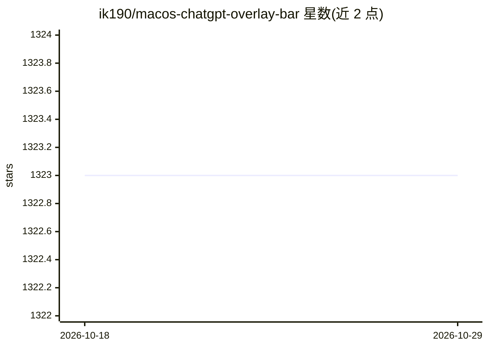

# ik190/macos-chatgpt-overlay-bar

⭐ 1,323 · 推送 2026-06-26 · [GitHub](https://github.com/ik190/macos-chatgpt-overlay-bar) · 个人维护

**常驻 macOS 菜单栏的 ChatGPT 快速访问浮层客户端**

面向 macOS 用户的轻量级桌面浮层应用：安装后常驻菜单栏，可从桌面任意位置快速唤出 ChatGPT 界面进行对话。定位为 ChatGPT 的独立第三方客户端，本身不提供模型，依赖 ChatGPT 服务；README 明确声明 ChatGPT 与 OpenAI 商标归 OpenAI 所有。安装方式为从 GitHub Releases 下载发布包并启动，无需编译。

## 筛选速览

| 维度 | 判定 | 备注 |
|---|---|---|
| AI 角色 | `ai-native` | 本体是模型或模型工具 |
| 许可风险 | `none` | — |
| 部署形态 | `None` |  |
| 模型依赖 | — | README 未给出锁定关系 |
| 硬件要求 | — | 无带数字的原话,不猜 |
| 安装摩擦 | `low` | 无编译、无系统依赖或容器化 |
| 成熟度 | — | 结构信号不足 |

## 能力要点

- 菜单栏常驻，桌面任意位置即时唤出 ChatGPT
- 从 GitHub Releases 下载发布包，免编译安装
- 自述为 ChatGPT 的独立客户端

## 适用场景

- 在 Mac 上随时快速打开 ChatGPT 对话
- 不切换浏览器或主窗口即可使用 ChatGPT

## 场景标签

`聊天机器人` · 领域:对话与助手

## 证据(README 行号)

> L3: A lightweight macOS overlay that provides instant access to ChatGPT from anywhere on your desktop.
> L18: This project is an independent client for ChatGPT.

## 星数曲线

2026-10-18 1,323 → 2026-10-29 1,323（+0）

---
*卡片 v1 · prompt 1.4 · 生成 2026-10-21 · 置信度 mid · 依据 README sha `2a22e6f3525c` · [字段定义](../../DATASET.md)*
