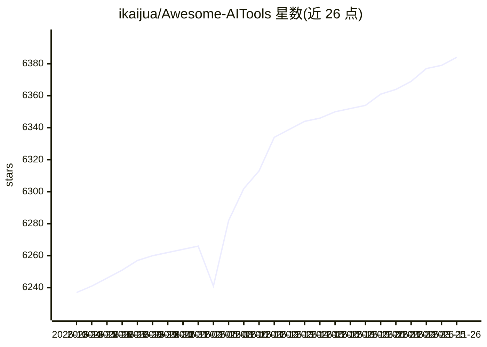

# ikaijua/Awesome-AITools

⭐ 6,384 · Python · CC-BY-4.0 · 推送 2026-11-24 · [GitHub](https://github.com/ikaijua/Awesome-AITools) · [官网](https://ikaijua.github.io/Awesome-AITools-Site/) · 个人维护

**面向所有用户的 AI 工具聚合清单**

一个持续更新的 awesome 系列聚合清单，按类别收录 AI 工具条目，每个条目含名称、描述、链接与收费信息。目录覆盖 37 个分类，包括 AI 助手与专有模型、决策模型、开源 LLM 等。支持通过 Watch→Custom→Releases 或 RSS 订阅每周新增条目，提供中英双语界面与推荐模板及贡献指南，接受社区推荐扩充条目。

## 筛选速览

| 维度 | 判定 | 备注 |
|---|---|---|
| AI 角色 | `ai-knowledge` | 知识聚合/清单类 |
| 许可风险 | `viral` | CC-BY-4.0 |
| 部署形态 | `None` |  |
| 模型依赖 | — | README 未给出锁定关系 |
| 硬件要求 | — | 无带数字的原话,不猜 |
| 安装摩擦 | `medium` | 含编译或系统依赖之一 |
| 成熟度 | — | 结构信号不足 |

## 能力要点

- 37 个分类组织 AI 工具条目，含名称/描述/链接/收费四栏
- 中英双语 README 与社区推荐模板、贡献指南
- 支持 Watch→Custom→Releases 或 RSS 订阅每周新增条目
- 收录条目含决策模型与开源 LLM 等类别

## 适用场景

- 按分类浏览查找某类 AI 工具
- 订阅每周新增的 AI 工具条目
- 按贡献模板向清单推荐新工具

## 场景标签

`精选清单` · 领域:学习与行业

## 证据(README 行号)

> L1: Awesome AI Tools
> L11: This repo collects awesome AI tools. Welcome everyone to recommend more awesome AI tools together! Please use the f
> L55: ## All Categories

## 星数曲线

2026-10-24 6,237 → 2026-11-26 6,384（+147）

---
*卡片 v1 · prompt 1.4 · 生成 2026-11-26 · 置信度 high · 依据 README sha `704145cc82f6` · [字段定义](../../DATASET.md)*
