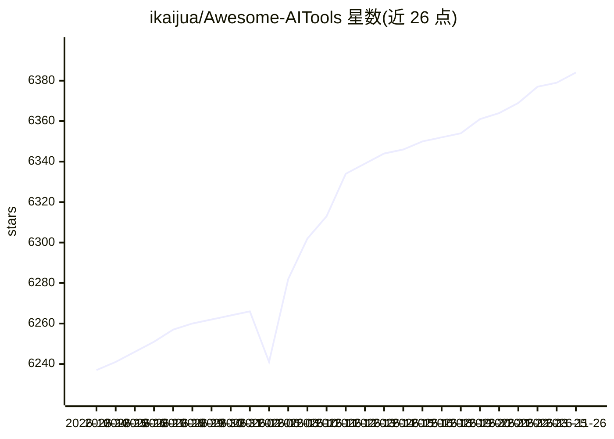

# ikaijua/Awesome-AITools

⭐ 6,384 · Python · CC-BY-4.0 · 推送 2026-11-24 · [GitHub](https://github.com/ikaijua/Awesome-AITools) · [官网](https://ikaijua.github.io/Awesome-AITools-Site/) · 个人维护 · 中文 README

**收录各类 AI 工具的 awesome 清单，社区共同推荐维护**

按分类组织的 AI 工具收录清单，中英双语，包含 AI 助手与专有模型、决策模型、开源 LLM、LLM 排行榜等类别，每条以名称/描述/链接/费用四列表格呈现。通过 Watch → Custom → Releases 或 RSS 订阅每周新增条目，提供推荐模板与贡献指南，接受社区推荐并设有赞助栏目。目录共 37 行分类，含商业 API、开源模型与多类工具入口。

## 筛选速览

| 维度 | 判定 | 备注 |
|---|---|---|
| AI 角色 | `ai-knowledge` | 知识聚合/清单类 |
| 许可风险 | `viral` | CC-BY-4.0 |
| 部署形态 | `None` |  |
| 模型依赖 | — | README 未给出锁定关系 |
| 硬件要求 | — | 无带数字的原话,不猜 |
| 安装摩擦 | `medium` | 含编译或系统依赖之一 |
| 成熟度 | — | 结构信号不足 |

## 能力要点

- 中英双语的多类别 AI 工具清单
- 条目以名称/描述/链接/费用表格组织
- 支持 RSS 与 GitHub Releases 订阅每周新增
- 提供推荐模板与贡献指南

## 适用场景

- 查找某类任务的 AI 工具候选
- 关注 AI 工具生态的新增条目
- 按费用信息筛选免费或付费工具

## 场景标签

`精选清单` · 领域:学习与行业

## 证据(README 行号)

> L11: This repo collects awesome AI tools. Welcome everyone to recommend more awesome AI tools together! Please use the f
> L31: ## All Categories

## 星数曲线

2026-10-24 6,237 → 2026-11-26 6,384（+147）

---
*卡片 v1 · prompt 1.4 · 生成 2026-11-22 · 置信度 high · 依据 README sha `6868fc18233f` · [字段定义](../../DATASET.md)*
