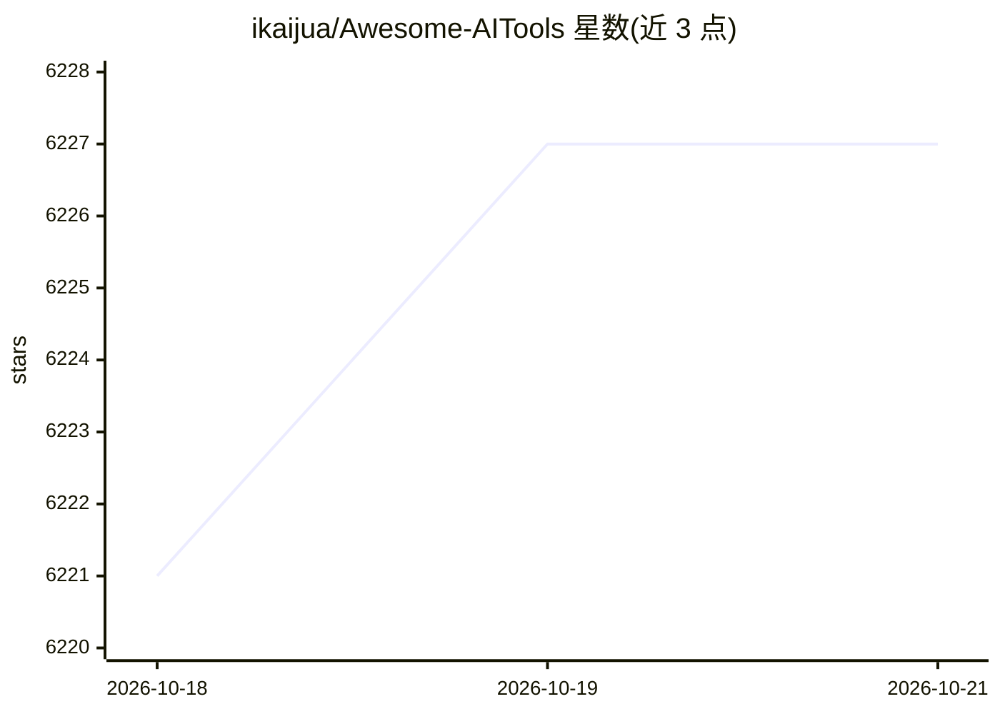

# ikaijua/Awesome-AITools

⭐ 6,227 · Python · CC-BY-4.0 · 推送 2026-10-19 · [GitHub](https://github.com/ikaijua/Awesome-AITools) · [官网](https://ikaijua.github.io/Awesome-AITools-Site/) · 个人维护 · 中文 README

**AI 工具收录清单：分类汇总助手、模型、开发工具等资源**

社区维护的 awesome-list 类型仓库，以中英双语 README 收录 AI 相关工具与服务，通过 issue 模板与贡献指南接受社区推荐。已可见的分类包括 AI 助手与专有模型、决策模型、开源 LLM 等，条目以表格形式给出名称、描述、链接与收费情况。仓库本身不提供可安装运行的软件，仅作为资源目录使用；另含赞助商展示区（AI API 中转服务）。

## 筛选速览

| 维度 | 判定 | 备注 |
|---|---|---|
| AI 角色 | `ai-knowledge` | 知识聚合/清单类 |
| 许可风险 | `viral` | CC-BY-4.0 |
| 部署形态 | `library` | 以包/库形式分发 |
| 模型依赖 | — | README 未给出锁定关系 |
| 硬件要求 | — | 无带数字的原话,不猜 |
| 安装摩擦 | `medium` | 含编译或系统依赖之一 |
| 成熟度 | — | 结构信号不足 |

## 能力要点

- 中英双语 AI 工具清单，覆盖助手、决策模型、开源 LLM 等多个分类
- 条目以表格组织，标注链接与免费/付费信息
- 提供 issue 推荐模板与贡献指南

## 适用场景

- 查找各类 AI 助手、开源模型与工具的入口
- 通过 PR/issue 向社区推荐自己的 AI 工具
- 按分类浏览了解 AI 工具生态覆盖范围

## 场景标签

`精选清单` · 领域:学习与行业

## 证据(README 行号)

> L1: Awesome AI Tools
> L9: This repo collects awesome AI tools. Welcome everyone to recommend more awesome AI tools together! Please use the fo
> L33: ### AI Assistants & Proprietary Models

## 星数曲线

2026-10-18 6,221 → 2026-10-21 6,227（+6）

---
*卡片 v1 · prompt 1.4 · 生成 2026-10-20 · 置信度 high · 依据 README sha `e4a816e97e3b` · [字段定义](../../DATASET.md)*
