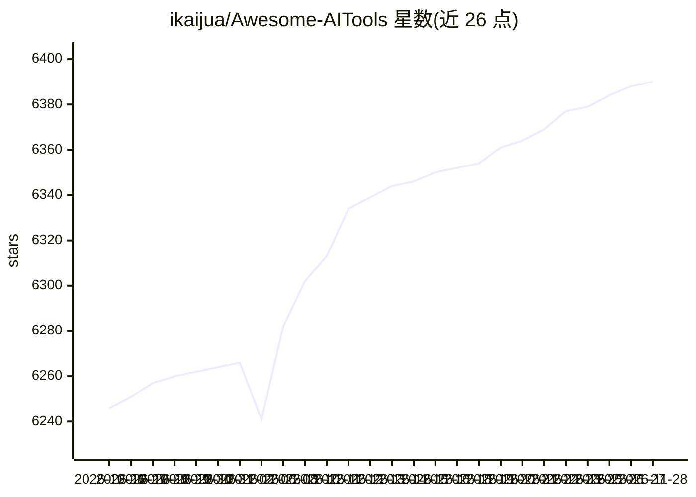

# ikaijua/Awesome-AITools

⭐ 6,390 · Python · CC-BY-4.0 · 推送 2026-11-27 · [GitHub](https://github.com/ikaijua/Awesome-AITools) · [官网](https://ikaijua.github.io/Awesome-AITools-Site/) · 个人维护 · 中文 README

**AI 工具聚合清单：按类别收集并持续更新各类 AI 工具**

以 awesome-list 形式维护的 AI 工具目录，中英双语，按 AI 助手、决策模型、开源 LLM 等类别以表格收录条目，每条含名称、描述、链接与费用信息。提供推荐模板与贡献指南，支持通过 Watch/RSS 订阅每周新增条目，页面含赞助栏目。条目覆盖闭源助手（ChatGPT、Claude 等）、开源权重模型及各类工具链接，供使用者检索与浏览。

## 筛选速览

| 维度 | 判定 | 备注 |
|---|---|---|
| AI 角色 | `ai-knowledge` | 知识聚合/清单类 |
| 许可风险 | `viral` | CC-BY-4.0 |
| 部署形态 | `None` |  |
| 模型依赖 | — | README 未给出锁定关系 |
| 硬件要求 | — | 无带数字的原话,不猜 |
| 安装摩擦 | `low` | 无编译、无系统依赖或容器化 |
| 成熟度 | — | 结构信号不足 |

## 能力要点

- 37 个类别的分类目录（README 目录段标注）
- 双语维护（English | 中文）
- 条目含链接与费用信息，附推荐模板与贡献指南
- 支持 RSS/Releases 订阅每周新增条目

## 适用场景

- 按类别浏览查找某类 AI 工具
- 寻找开源可自部署的大模型选项
- 了解各 AI 助手的接入链接与收费方式

## 场景标签

`精选清单` · 领域:学习与行业

## 证据(README 行号)

> L11: This repo collects awesome AI tools. Welcome everyone to recommend more awesome AI tools together! Please use the f
> L55: ## All Categories
> L59: |Name|Description|Links|Fees|

## 星数曲线

2026-10-26 6,246 → 2026-11-28 6,390（+144）

---
*卡片 v1 · prompt 1.4 · 生成 2026-11-28 · 置信度 high · 依据 README sha `083d1516d4d8` · [字段定义](../../DATASET.md)*
