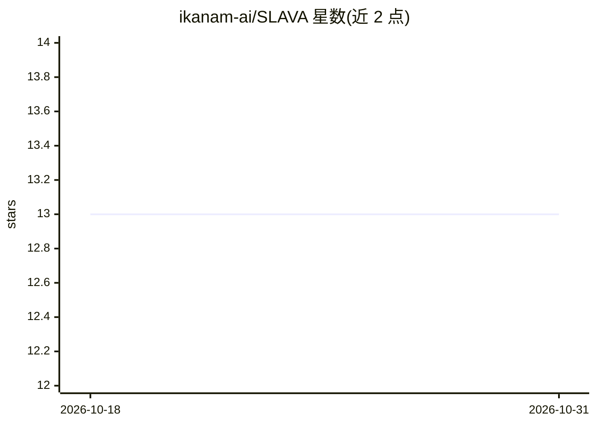

# ikanam-ai/SLAVA

⭐ 13 · Python · MIT · 推送 2026-10-21 · [GitHub](https://github.com/ikanam-ai/SLAVA) · [官网](https://huggingface.co/spaces/RANEPA-ai/SLAVA) · 组织维护

**评测俄语语境下 LLM 事实准确性的社会政治基准数据集与框架**

SLAVA 是面向俄语语境的 LLM 事实准确性评测基准：提供覆盖俄罗斯社会政治话题的开放问答数据集（托管于 Hugging Face），并附带计算多项指标的框架代码，可对模型生成事实正确回答的能力进行评估，结果以排行榜形式展示供模型间比较。安装方式为克隆仓库后用 Poetry 管理依赖，notebooks 目录演示框架各模块用法。仓库由 RANEPA 相关作者维护，采用 MIT 许可。

## 筛选速览

| 维度 | 判定 | 备注 |
|---|---|---|
| AI 角色 | `ai-knowledge` | 知识聚合/清单类 |
| 许可风险 | `permissive` | MIT |
| 部署形态 | `None` |  |
| 模型依赖 | — | README 未给出锁定关系 |
| 硬件要求 | — | 无带数字的原话,不猜 |
| 安装摩擦 | `low` | 无编译、无系统依赖或容器化 |
| 成熟度 | — | 结构信号不足 |

## 能力要点

- 面向俄语社会政治语境的事实准确性评测数据集
- 提供指标计算功能评估模型回答的事实正确性
- 结果以排行榜形式展示，支持模型间比较
- 通过 Hugging Face 发布数据集与在线演示

## 适用场景

- 我需要评测自研 LLM 在俄语事实性问题上的表现
- 我想对比不同模型在俄语社会政治话题上的准确性
- 我在为俄语场景选型时查找可参照的评测基准

## 场景标签

`模型评测` · 领域:评测与运维

## 证据(README 行号)

> L15: # SLAVA: Benchmark of Sociopolitical Landscape and Value Analysis
> L25: This repository provides access to the SLAVA dataset, an open dataset of questions specifically designed to evaluat

## 星数曲线

2026-10-18 13 → 2026-10-31 13（+0）

---
*卡片 v1 · prompt 1.4 · 生成 2026-10-31 · 置信度 high · 依据 README sha `f31695058b40` · [字段定义](../../DATASET.md)*
