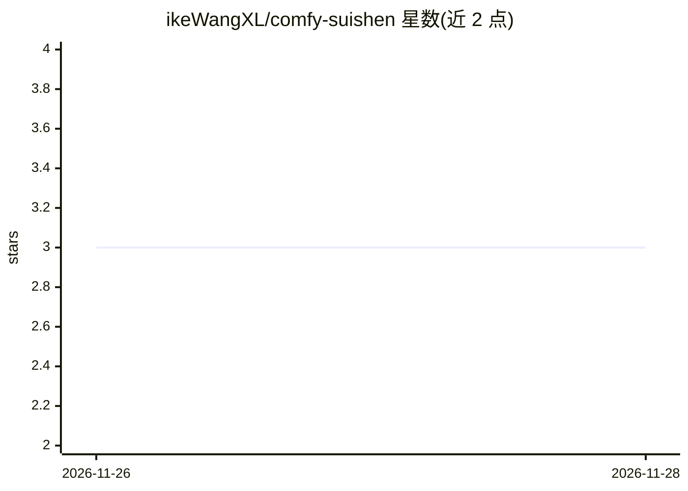

# ikeWangXL/comfy-suishen

⭐ 3 · TypeScript · NOASSERTION · 推送 2026-11-19 · [GitHub](https://github.com/ikeWangXL/comfy-suishen) · 个人维护 · 中文 README

**用鸿蒙 App 或浏览器远程提交 ComfyUI 出图任务**

由 Server（Windows）+ 鸿蒙 App + Web 版三部分组成的远程控制方案：App 或浏览器通过局域网连接电脑上的 ComfyUI，提交生成任务、查看进度、浏览图片。Server 端提交任务时把 ComfyUI 内置 SaveImage 节点替换为 PreviewImage，经 temp 写入后归档到用户图库，避免重复保存原图；支持上传任意 API 格式工作流 JSON 并按节点类型识别保存节点。依赖已能出图的 ComfyUI，需手机与电脑同一局域网。

## 筛选速览

| 维度 | 判定 | 备注 |
|---|---|---|
| AI 角色 | `ai-native` | 本体是模型或模型工具 |
| 许可风险 | `none` | NOASSERTION |
| 部署形态 | `None` |  |
| 模型依赖 | — | README 未给出锁定关系 |
| 硬件要求 | — | 无带数字的原话,不猜 |
| 安装摩擦 | `low` | 无编译、无系统依赖或容器化 |
| 成熟度 | — | 结构信号不足 |

## 能力要点

- 鸿蒙 App（.hap 侧载）与浏览器 Web 版双客户端
- 自动替换 SaveImage 为 PreviewImage，原图归档到用户图库
- 支持上传任意 API 格式工作流 JSON，可加标记调整手机端参数
- App 操作演示视频与操作手册

## 适用场景

- 在鸿蒙手机上远程控制电脑的 ComfyUI 出图
- 手机、平板、浏览器多端查看生成进度与图库
- 把自定义工作流导入手机端调整参数后出图

## 场景标签

`图像生成` · 领域:内容生成

## 证据(README 行号)

> L3: 用鸿蒙 App 或浏览器连接 Windows 电脑上的 ComfyUI，提交生成任务、查看进度和浏览图片。
> L41: 为了避免 App 出图在 ComfyUI 的 `output` 和用户图库各留下一个长期保存的原图，Server 在提交任务时，将执行副本里的 ComfyUI 内置 `SaveImage` 节点换成 `PreviewImage`。

## 星数曲线

2026-11-26 3 → 2026-11-28 3（+0）

---
*卡片 v1 · prompt 1.4 · 生成 2026-11-26 · 置信度 high · 依据 README sha `6c4e475957f1` · [字段定义](../../DATASET.md)*
