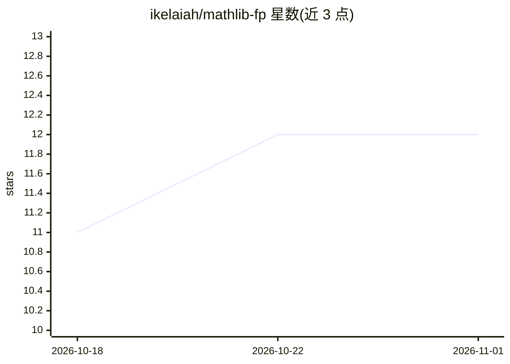

# ikelaiah/mathlib-fp

⭐ 12 · Pascal · MIT · 推送 2026-10-22 · [GitHub](https://github.com/ikelaiah/mathlib-fp) · [官网](https://ikelaiah.github.io/mathlib-fp/) · 个人维护

**Free Pascal 数值计算库：覆盖 13 个科学计算域，无第三方依赖**

面向 Free Pascal 3.2.2+/Lazarus 4.8+ 的纯源码数学库，以 objfpc 模式编写，无第三方运行时依赖。涵盖 13 个领域：矩阵/线性代数、金融、统计、工程、数值方法、概率、组合、优化、时间序列（ARIMA、Kalman）、机器学习（PLS 回归、聚类/PCA/LDA/森林）、几何与模型持久化。安装方式为 git clone 或下载源码包后将 src/ 加入 FPC 单元路径编译，无包管理器安装步骤。提供 52 个可运行示例与自动化测试套件。

## 筛选速览

| 维度 | 判定 | 备注 |
|---|---|---|
| AI 角色 | `ai-native` | 本体是模型或模型工具 |
| 许可风险 | `permissive` | MIT |
| 部署形态 | `desktop` | 安装包/桌面程序 |
| 模型依赖 | — | README 未给出锁定关系 |
| 硬件要求 | — | 无带数字的原话,不猜 |
| 安装摩擦 | `low` | 无编译、无系统依赖或容器化 |
| 成熟度 | — | 结构信号不足 |

## 能力要点

- 13 个独立可用的数学领域单元族
- 无第三方运行时依赖，仅需 FPC 3.2.2+
- MLLib 提供 PLS 回归、聚类/PCA/LDA/森林等
- InterchangeLib 支持拟合模型的版本化保存/加载与回放
- 52 个带注释的可运行示例

## 适用场景

- 在 Free Pascal 项目中做矩阵运算、解方程与统计分析
- 构建金融计算（NPV/IRR、期权）与工程单位换算功能
- 在 Lazarus 应用中嵌入回归、聚类等机器学习与时间序列预测

## 场景标签

 · 领域:科学计算/数值库

## 证据(README 行号)

> L6:  Scientific, statistical, financial, engineering, and machine-learning tools—with no third-party runtime dependencie
> L145: |MLLib|PLS regression for correlated predictors, leakage-safe preprocessing, regression/classification, typed clus

## 星数曲线

2026-10-18 11 → 2026-11-01 12（+1）

---
*卡片 v1 · prompt 1.4 · 生成 2026-11-01 · 置信度 high · 依据 README sha `283eb1edf77b` · [字段定义](../../DATASET.md)*
