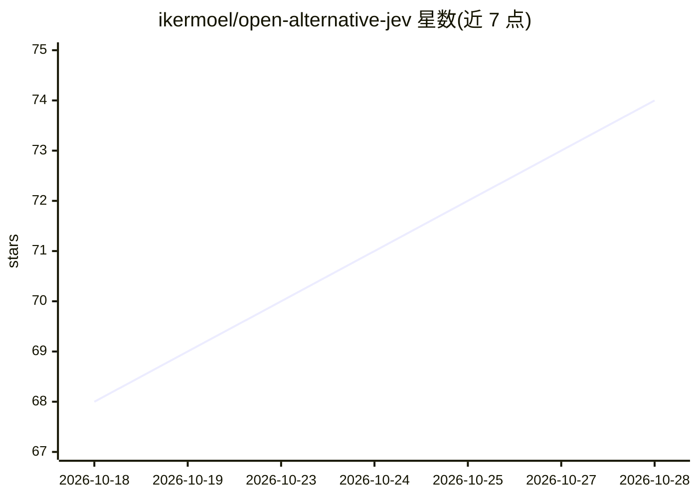

# ikermoel/open-alternative-jev

⭐ 74 · Python · Apache-2.0 · 推送 2026-09-25 · [GitHub](https://github.com/ikermoel/open-alternative-jev) · [官网](https://huggingface.co/spaces/IkerMoel/open-alternative-jev) · 个人维护

**开源库：让任意开源权重 LLM 一次前向输出类型化、校准的决策**

Python 包 `open-alternative-jev`（导入名 so1），实现 TypeSafe Jev 所代表 System One 模型思路的开源替代：不生成文本，模型读取一次共享状态后，从 next-token 分布在给定选项上直接读取答案，支持多问题打包（packed）以减少重复计算，并附 temperature scaling 校准工具（TemperatureScaler，用留出标签拟合单标量）。支持 Hugging Face Transformers 与 vLLM 双后端，面向在自有 GPU 上用已有开源权重模型（Qwen 系列）获得带概率的类型化决策的开发者。限制：无 HTTP 服务、非官方 Jev SDK 的替代端点；README 自述小模型（<4B）打包会损失精度，需用 separate 模式。

## 筛选速览

| 维度 | 判定 | 备注 |
|---|---|---|
| AI 角色 | `ai-ecosystem` | LLM/agent 周边工具 |
| 许可风险 | `permissive` | Apache-2.0 |
| 部署形态 | `library` | 以包/库形式分发 |
| 模型依赖 | local-ok | 支持本地模型 |
| 硬件要求 | — | 无带数字的原话,不猜 |
| 安装摩擦 | `medium` | 含编译或系统依赖之一 |
| 成熟度 | — | 结构信号不足 |

## 能力要点

- 从 next-token 分布读取选项答案，不生成文本
- 多问题打包：共享状态只写一次，减少 token 处理量
- TemperatureScaler 单标量温度校准（MMLU ECE 5.4%→2.1%）
- permutations=2 选项顺序平均，缓解位置偏差并降低 ECE

## 适用场景

- 用自有的 Qwen 等开源模型对共享文档批量回答类型化问题
- 为 yes/no、多选、有序评分等决策任务获得带校准概率的输出
- 对比 packed 与 separate 模式在精度与吞吐间做选择

## 场景标签

 · 领域:LLM 推理/结构化决策

## 证据(README 行号)

> L5: **Open-source System One models: typed, calibrated decisions from any open-weights LLM, in one forward pass.**
> L7: Python package `open-alternative-jev`, import name `so1` ("System One").
> L16: This replaces the library, not the endpoint: it is a Python package you call in-process, and there is no HTTP serve

## 星数曲线

2026-10-18 68 → 2026-10-28 74（+6）

---
*卡片 v1 · prompt 1.4 · 生成 2026-10-24 · 置信度 high · 依据 README sha `2af3f042cbdb` · [字段定义](../../DATASET.md)*
