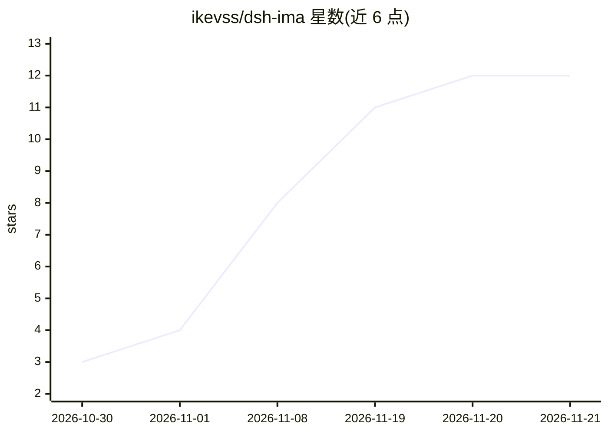

# ikevss/dsh-ima

⭐ 12 · JavaScript · MIT · 推送 2026-11-17 · [GitHub](https://github.com/ikevss/dsh-ima) · [官网](https://www.npmjs.com/package/ik-dsh-ima) · 个人维护 · 中文 README

**把腾讯 ima 知识库接入 DeepSeek Harness 的插件：浏览/搜索/上传**

DeepSeek Harness 的 DSH 插件，在侧边栏展示用户绑定的腾讯 ima 知识库：支持个人/共享库分组浏览、面板内预览 PDF/Word/Excel/PPT 等格式、跨库正文搜索并高亮命中。宿主半注册 5 读 2 写共 7 个 agent 工具，并在每轮对话开头注入知识库清单使模型主动检索；写入走 ima 官方 OpenAPI 三步上传，支持 23 种格式与网页链接收录。依赖 Node.js ≥18 与 ima 账号，绑定需 Chrome/Edge（可手动兜底）。

## 筛选速览

| 维度 | 判定 | 备注 |
|---|---|---|
| AI 角色 | `ai-ecosystem` | LLM/agent 周边工具 |
| 许可风险 | `permissive` | MIT |
| 部署形态 | `library` | 以包/库形式分发 |
| 模型依赖 | — | README 未给出锁定关系 |
| 硬件要求 | — | 无带数字的原话,不猜 |
| 安装摩擦 | `low` | 无编译、无系统依赖或容器化 |
| 成熟度 | — | 结构信号不足 |

## 能力要点

- 7 个 agent 工具（5 读 + 2 写：ima_upload_file / ima_add_url）
- 每轮对话注入知识库清单，模型主动检索
- 面板内预览 PDF/Word/Excel/PPT/音视频等格式
- 写入走 ima 官方 OpenAPI 三步上传，支持 23 种格式

## 适用场景

- 在对话中直接让 agent 搜索 ima 里的资料内容
- 把本地文件或网页文章收录进 ima 知识库
- 侧边栏浏览和预览 ima 里的文档与会议笔记

## 场景标签

`知识库管理` · 领域:知识与检索

## 证据(README 行号)

> L11: > 把腾讯 ima 的知识库接进 DeepSeek Harness：侧边栏浏览知识库，**agent 能自动检索、读取，也能往里写**。
> L41: |Agent 工具|7 个工具：5 个读 + 2 个写（`ima_upload_file` / `ima_add_url`）|
> L312: **两半设计**：宿主半跑在 Node 里（工具、HTTP 路由），浏览器半跑在 DSH 页面里（侧边栏面板、预览）。两者通过同源的 `/api/ima/*` 通信。

## 星数曲线

2026-10-30 3 → 2026-11-21 12（+9）

---
*卡片 v1 · prompt 1.4 · 生成 2026-11-19 · 置信度 high · 依据 README sha `63204946815a` · [字段定义](../../DATASET.md)*
