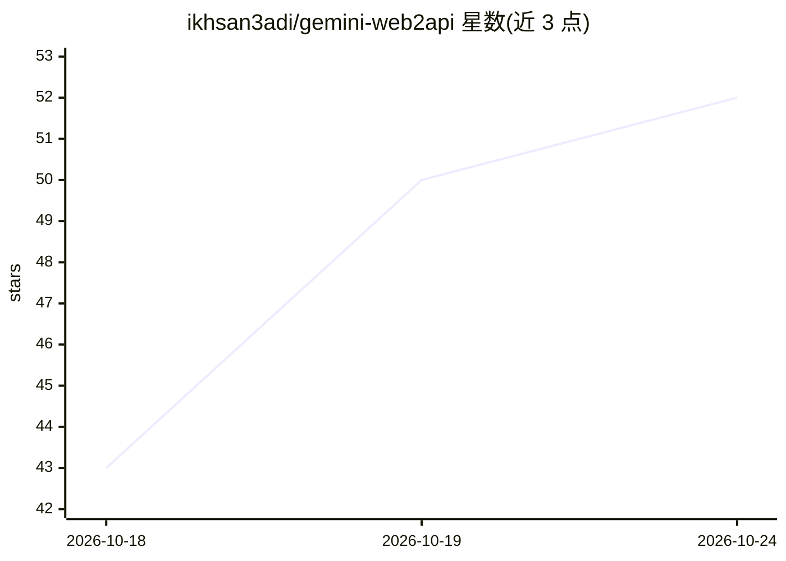

# ikhsan3adi/gemini-web2api

⭐ 52 · Go · MIT · 推送 2026-10-20 · [GitHub](https://github.com/ikhsan3adi/gemini-web2api) · 个人维护 · 中文 README

**将 Gemini 网页版转为 OpenAI 兼容 API 的 Go 代理**

原 Python 版 gemini-web2api 的 Go 重写版，把 Google Gemini 网页界面封装为 OpenAI 兼容的 HTTP API（/v1/chat/completions、/v1/models、/v1/responses），也支持 Gemini CLI 的原生端点。以单一静态二进制分发，零运行时依赖，支持多模态图像上传、函数调用、流式 SSE、TLS 指纹模拟绕过 WAF。匿名访问可用 Flash 模型，Pro/Argon 模型需付费账号 Cookie；限制包括单轮对话模拟多轮、Google 可能限流。给需要在各类 OpenAI 客户端中调用 Gemini 的开发者使用。

## 筛选速览

| 维度 | 判定 | 备注 |
|---|---|---|
| AI 角色 | `ai-ecosystem` | LLM/agent 周边工具 |
| 许可风险 | `permissive` | MIT |
| 部署形态 | `desktop` | 安装包/桌面程序 |
| 模型依赖 | — | README 未给出锁定关系 |
| 硬件要求 | — | 无带数字的原话,不猜 |
| 安装摩擦 | `low` | 无编译、无系统依赖或容器化 |
| 成熟度 | — | 结构信号不足 |

## 能力要点

- OpenAI 兼容 /v1/chat/completions、/v1/models、/v1/responses（Codex CLI）
- 多模态图像上传（image_url/base64，经 Scotty Resumable Upload）
- TLS Impersonation 模拟 Chrome/Edge 指纹以绕过 Cloudflare/WAF
- 纯 Go 单一静态二进制，零运行时依赖

## 适用场景

- 在 Cherry Studio/ChatBox 等 OpenAI 客户端中接入 Gemini
- 为 Codex CLI 或 Gemini CLI 提供自定义后端
- 以零成本方式在脚本/SDK 中调用 Gemini 模型

## 场景标签

`模型网关` · 领域:Agent 开发

## 证据(README 行号)

> L7: High-performance Go proxy converting Google Gemini's web interface into an OpenAI-compatible API. Zero cost, cross-p
> L14: - **OpenAI Compatible**: Drop-in replacement for `/v1/chat/completions`, `/v1/models`, and `/v1/responses` (Codex C

## 星数曲线

2026-10-18 43 → 2026-10-24 52（+9）

---
*卡片 v1 · prompt 1.4 · 生成 2026-10-24 · 置信度 high · 依据 README sha `5dd3f3d71ca3` · [字段定义](../../DATASET.md)*
