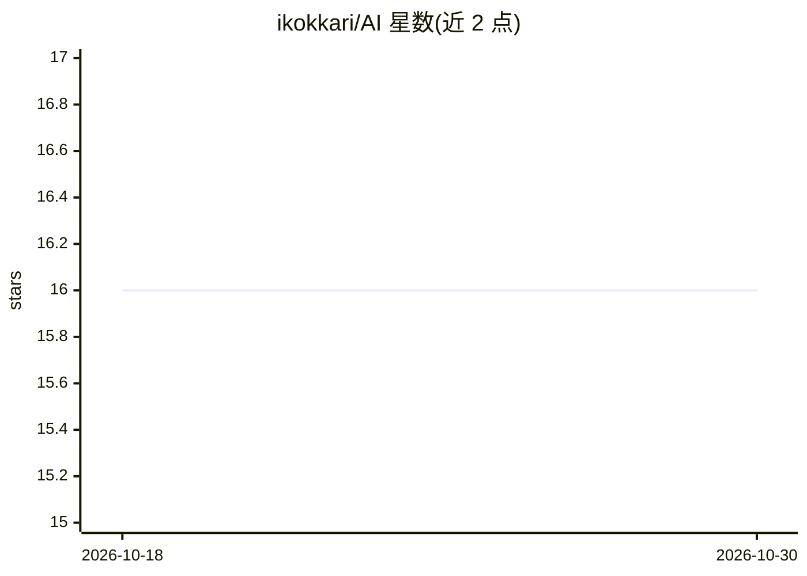

# ikokkari/AI

⭐ 16 · Java · GPL-3.0 · 推送 2026-04-06 · [GitHub](https://github.com/ikokkari/AI) · 个人维护

**大学 AI 课程的教学材料集：讲义、阅读与 Prolog/Java/Python 代码**

Ryerson University（Chang School）CCPS 721 Artificial Intelligence I 课程资料仓库，作者 Ilkka Kokkarinen。内容包含课程讲义、补充阅读材料，以及作者用 Prolog、Java 和 Python 编写的课程代码。全部材料以 GNU GPL v3 许可发布，面向计算机科学的学生与教师，欢迎下载、使用、改编和在各自课程中分发。README 未给出安装运行命令。

## 筛选速览

| 维度 | 判定 | 备注 |
|---|---|---|
| AI 角色 | `ai-knowledge` | 知识聚合/清单类 |
| 许可风险 | `viral` | GPL-3.0 |
| 部署形态 | `None` |  |
| 模型依赖 | — | README 未给出锁定关系 |
| 硬件要求 | — | 无带数字的原话,不猜 |
| 安装摩擦 | `low` | 无编译、无系统依赖或容器化 |
| 成熟度 | — | 结构信号不足 |

## 能力要点

- 课程讲义与补充阅读材料
- Prolog、Java、Python 三种语言的课程代码
- GNU GPL v3 许可，允许教学场景改编与分发

## 适用场景

- 高校教师用这些材料搭建自己的 AI 导论课程
- 学生自学经典人工智能课程内容并运行配套代码

## 场景标签

`教程课程` · 领域:学习与行业

## 证据(README 行号)

> L3: Materials for the course **CCPS 721 Artificial Intelligence I**, as taught by Ilkka Kokkarinen for Chang School of C
> L5: The notes, extra reading material and the Prolog, Java and Python code by Ilkka Kokkarinen are released under GNU Ge

## 星数曲线

2026-10-18 16 → 2026-10-30 16（+0）

---
*卡片 v1 · prompt 1.4 · 生成 2026-10-30 · 置信度 high · 依据 README sha `c952ddf525dd` · [字段定义](../../DATASET.md)*
