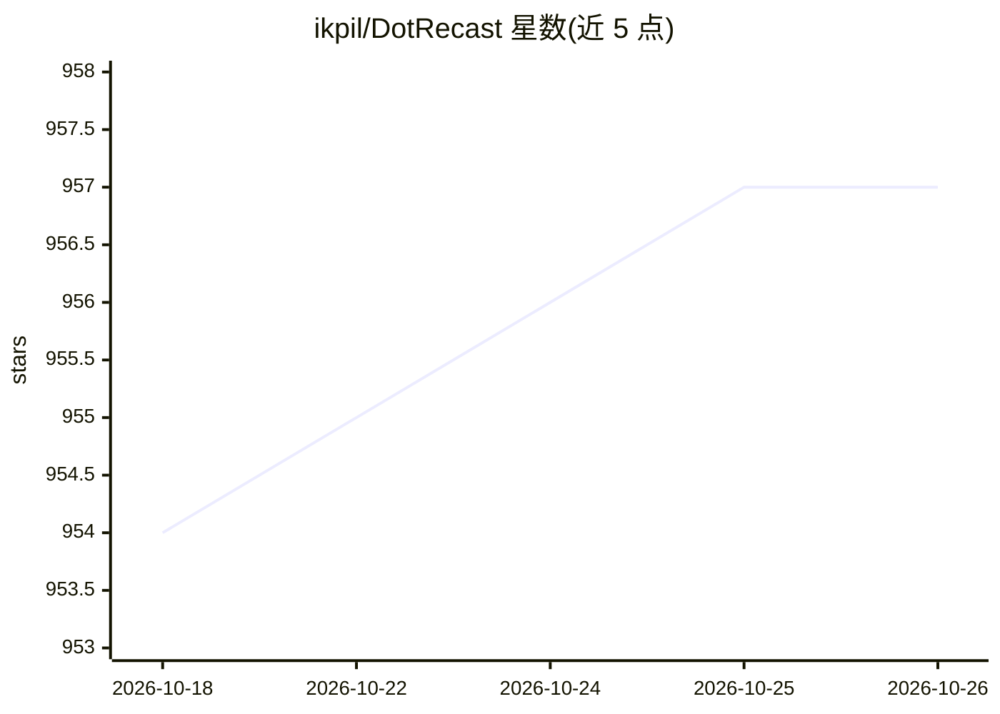

# ikpil/DotRecast

⭐ 957 · C# · Zlib · 推送 2026-10-03 · [GitHub](https://github.com/ikpil/DotRecast) · 个人维护

**Recast & Detour 的 C# 移植：游戏导航网格生成与寻路库**

将 recastnavigation 与 recast4j 移植到 C# 的导航网格工具集，面向 .NET、Unity3D、游戏与服务器开发。通过多步栅格化流程从任意关卡几何体生成 navmesh（体素化、过滤不可通行区域、划分多边形区域、重三角化），支持单体网格与瓦片网格两种构建方式。模块化拆分为核心工具、navmesh 生成、寻路查询、TileCache 流式加载、人群避让模拟、动态 navmesh 等模块。构建仅需 .NET 编译器，无其他依赖，以 ZLib 许可发布。

## 筛选速览

| 维度 | 判定 | 备注 |
|---|---|---|
| AI 角色 | `ai-enhanced` | 去掉 AI 部分产品仍成立 |
| 许可风险 | `viral` | Zlib |
| 部署形态 | `None` |  |
| 模型依赖 | — | README 未给出锁定关系 |
| 硬件要求 | — | 无带数字的原话,不猜 |
| 安装摩擦 | `low` | 无编译、无系统依赖或容器化 |
| 成熟度 | — | 结构信号不足 |

## 能力要点

- 从任意关卡几何体自动生成导航网格
- 瓦片网格支持重烘焙、分层寻路与 navmesh 数据流式加载
- 人群模拟模块提供 agent 移动与避碰
- 模块化设计，构建仅需 .NET 编译器、无第三方依赖

## 适用场景

- Unity3D 或 .NET 游戏项目集成寻路与人群避让
- 大世界/开放世界场景使用 TileCache 流式加载 navmesh
- 运行时增删动态物体的导航网格维护

## 场景标签

 · 领域:游戏开发/导航

## 证据(README 行号)

> L3: *DotRecast is C# Recast & Detour, a port of recastnavigation and recast4j to the C# language.*
> L27: - 💪 Industry Standard - Recast powers AI navigation features in Unity, Unreal, Godot, O3DE and countless AAA and in
> L33: - DotRecast.Detour : Runtime loading of navmesh data, pathfinding, navmesh queries

## 星数曲线

2026-10-18 954 → 2026-10-26 957（+3）

---
*卡片 v1 · prompt 1.4 · 生成 2026-10-21 · 置信度 mid · 依据 README sha `08fc5eaa6cfc` · [字段定义](../../DATASET.md)*
