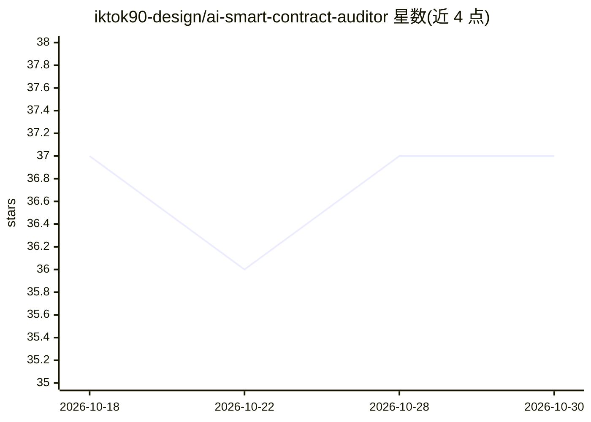

# iktok90-design/ai-smart-contract-auditor

⭐ 37 · TypeScript · MIT · 推送 2026-10-04 · [GitHub](https://github.com/iktok90-design/ai-smart-contract-auditor) · 组织维护

**面向 Claude Code 的智能合约安全审计插件**

AuditSentry 是运行于 Claude Code 的安全审计工具，通过 13 个 MCP 服务器（区块浏览器、Foundry/Hardhat 编译测试、Anvil 主网分叉、Slither/Mythril 静态分析等）与 23 个专项 Agent 执行 Solidity/Vyper 合约漏洞检测、可执行漏洞 PoC 生成、主网分叉模拟、Gas 分析与多格式审计报告，提供 45 个斜杠命令。安装方式为 git clone 后 make build，依赖 Node.js ≥18、Git、make，需在 Claude Code 内以插件形式加载。

## 筛选速览

| 维度 | 判定 | 备注 |
|---|---|---|
| AI 角色 | `ai-ecosystem` | LLM/agent 周边工具 |
| 许可风险 | `permissive` | MIT |
| 部署形态 | `library` | 以包/库形式分发 |
| 模型依赖 | locked-api |  |
| 硬件要求 | — | 无带数字的原话,不猜 |
| 安装摩擦 | `low` | 无编译、无系统依赖或容器化 |
| 成熟度 | — | 结构信号不足 |

## 能力要点

- 13 个 MCP 服务器覆盖编译、测试、分叉模拟与静态/符号分析
- 23 个专项 Agent 并行检测，发现去重并按 CVSS 评分
- 为每个发现生成可执行的 Foundry/Hardhat 漏洞 PoC
- 45 个斜杠命令覆盖审计、漏洞利用、测试、报告与通知流程

## 适用场景

- 在 Claude Code 中对我的 Solidity/Vyper 合约做漏洞审计
- 为审计发现生成可执行验证的漏洞 PoC 与主网分叉模拟
- 生成 Markdown/HTML/PDF 格式的审计报告

## 场景标签

`代码审查` · 领域:编码与开发

## 证据(README 行号)

> L10: > **AI-driven security analysis for Solidity & Vyper smart contracts.** AuditSentry combines Claude Code with 13 sp
> L79: git clone https://github.com/iktok90-design/ai-smart-contract-auditor.git ~/.claude/skills/auditsentry
> L151: |Server|Function|

## 星数曲线

2026-10-18 37 → 2026-10-30 37（+0）

---
*卡片 v1 · prompt 1.4 · 生成 2026-10-25 · 置信度 mid · 依据 README sha `a088807194e9` · [字段定义](../../DATASET.md)*
