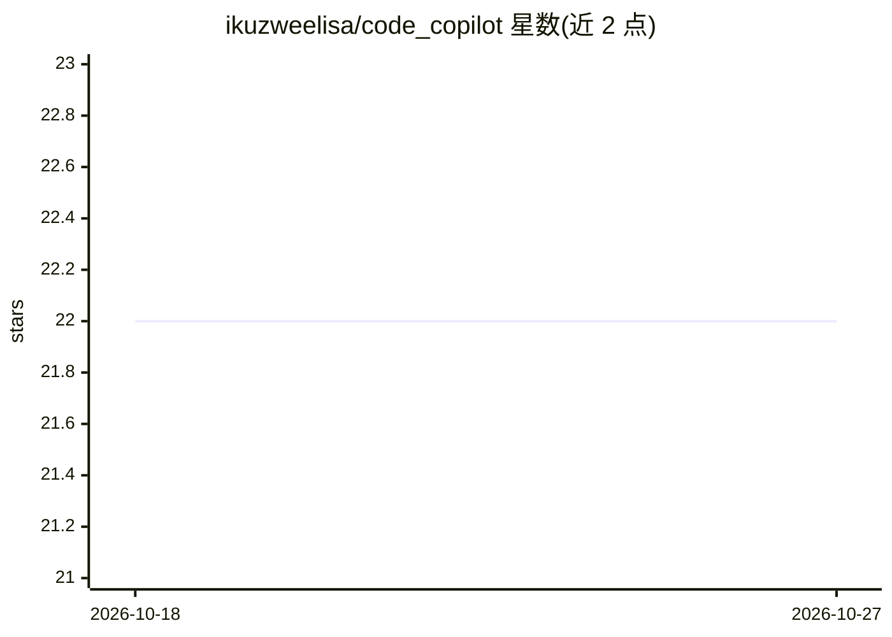

# ikuzweelisa/code_copilot

⭐ 22 · TypeScript · MIT · 推送 2026-10-23 · [GitHub](https://github.com/ikuzweelisa/code_copilot) · [官网](https://code-copilot.vercel.app/) · 个人维护

**基于 Next.js 的编程助手聊天机器人**

一个使用 Next.js App Router、React 与 TypeScript 构建的聊天机器人应用，面向编程辅助场景：可生成回复、复制/重新生成消息、上传附件，并通过数据库保存、读取、更新和删除聊天记录、展示历史会话。AI 能力依赖 Vercel AI SDK（ai 库）实现，认证由 Auth.js 提供。README 自述部分功能可能不完善或含 bug，欢迎贡献。安装方式为 pnpm install 后 pnpm run dev 运行开发服务。

## 筛选速览

| 维度 | 判定 | 备注 |
|---|---|---|
| AI 角色 | `ai-native` | 本体是模型或模型工具 |
| 许可风险 | `permissive` | MIT |
| 部署形态 | `None` |  |
| 模型依赖 | — | README 未给出锁定关系 |
| 硬件要求 | — | 无带数字的原话,不猜 |
| 安装摩擦 | `low` | 无编译、无系统依赖或容器化 |
| 成熟度 | `idea` | |

## 能力要点

- 生成回复、复制与重新生成消息
- 聊天记录的数据库保存/读取/更新/删除与历史展示
- 支持上传附件

## 适用场景

- 作为编程问答助手与 AI 对话
- 保留和回看历史聊天记录
- 在对话中附带文件提问

## 场景标签

`聊天机器人` · 领域:对话与助手

## 证据(README 行号)

> L11: - [x] Generate Response
> L29: - ai - A Library for AI building Applications

## 星数曲线

2026-10-18 22 → 2026-10-27 22（+0）

---
*卡片 v1 · prompt 1.4 · 生成 2026-10-27 · 置信度 mid · 依据 README sha `993029bae745` · [字段定义](../../DATASET.md)*
