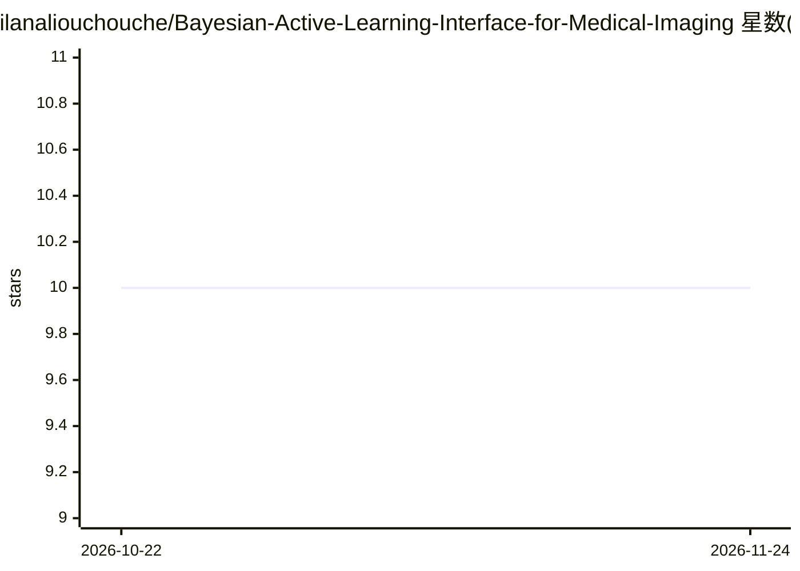

# ilanaliouchouche/Bayesian-Active-Learning-Interface-for-Medical-Imaging

⭐ 10 · JavaScript · 推送 2026-01-23 · [GitHub](https://github.com/ilanaliouchouche/Bayesian-Active-Learning-Interface-for-Medical-Imaging) · 个人维护

**面向医学专业人员的教学式主动学习界面，结合 BNN 与领域知识**

基于 Marcelle（交互式机器学习 JS 包）构建的前端应用，后端用 FastAPI 提供 Python 推理与训练服务。核心机制是主动学习：医生作为标注者（oracle）对模型不确定的预测进行标注，新数据并入训练集后通过界面触发模型重训练；界面提供实时性能指标、不确定性可视化图表，并集成 TensorBoard 监控训练过程。应用包含主页、Machine Teaching、Training、Report 等标签页，模型部分为预训练 CNN 与贝叶斯神经网络组合。安装需克隆仓库、pip 安装 Python 依赖、npm 安装前端。

## 筛选速览

| 维度 | 判定 | 备注 |
|---|---|---|
| AI 角色 | `ai-native` | 本体是模型或模型工具 |
| 许可风险 | `none` | — |
| 部署形态 | `library` | 以包/库形式分发 |
| 模型依赖 | — | README 未给出锁定关系 |
| 硬件要求 | — | 无带数字的原话,不猜 |
| 安装摩擦 | `low` | 无编译、无系统依赖或容器化 |
| 成熟度 | — | 结构信号不足 |

## 能力要点

- 医生作为 oracle 标注不确定预测以迭代改进 BNN
- 界面提供实时性能指标与不确定性可视化
- TensorBoard 集成实时监控训练日志与模型演化
- 预训练 CNN 与贝叶斯神经网络组合建模

## 适用场景

- 医学专业人员参与模型教学，标注疑难样本改进模型
- 在界面中观察模型重训练过程与不确定性表现
- 交互式机器学习教学与演示场景

## 场景标签

 · 领域:医疗/人机交互与机器学习

## 证据(README 行号)

> L3: This project aims to integrate domain knowledge with deep learning through an intuitive interface designed for medic
> L17: 1. **Active Learning & Model Teaching**: The user/oracle (a doctor) labels uncertain predictions, helping refine th

## 星数曲线

2026-10-22 10 → 2026-11-24 10（+0）

---
*卡片 v1 · prompt 1.4 · 生成 2026-11-19 · 置信度 high · 依据 README sha `c64a66a42d2b` · [字段定义](../../DATASET.md)*
