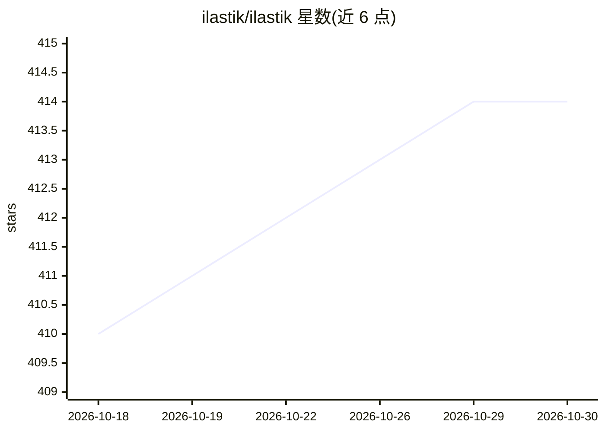

# ilastik/ilastik

⭐ 414 · Python · NOASSERTION · 推送 2026-10-28 · [GitHub](https://github.com/ilastik/ilastik) · [官网](https://ilastik.org) · 组织维护

**交互式机器学习工具：生物图像的分割、分类、追踪与计数**

面向生命科学/显微成像研究者的交互式学习与分割工具包：用户在数据上绘制标签，即使用机器学习算法对细胞等实验数据进行分割、分类、追踪和计数，大多数操作在大型数据集上也是交互式的，无需机器学习专业知识。以 Qt/Python 构建，提供工作流引导式界面；安装方式包括官网二进制安装包和 conda 包（conda 通道标注为 experimental），稳定版 1.4.1 基于 Python 3.9。GPL 许可。

## 筛选速览

| 维度 | 判定 | 备注 |
|---|---|---|
| AI 角色 | `ai-native` | 本体是模型或模型工具 |
| 许可风险 | `none` | NOASSERTION |
| 部署形态 | `None` |  |
| 模型依赖 | — | README 未给出锁定关系 |
| 硬件要求 | — | 无带数字的原话,不猜 |
| 安装摩擦 | `low` | 无编译、无系统依赖或容器化 |
| 成熟度 | `idea` | |

## 能力要点

- 绘制标签即时查看结果的交互式像素分类工作流
- 支持分割、分类、追踪与计数
- 无需机器学习专业知识即可使用
- 提供二进制安装包与 conda 安装两种方式

## 适用场景

- 显微图像中细胞的分割与计数
- 通过绘制标签训练分类器处理实验数据
- 无 ML 背景的生物研究者做图像分析

## 场景标签

`目标检测` · 领域:感知与多模态

## 证据(README 行号)

> L5: > The interactive learning and segmentation toolkit
> L14: Leverage machine learning algorithms to easily segment, classify, track and count your cells or other experimental 

## 星数曲线

2026-10-18 410 → 2026-10-30 414（+4）

---
*卡片 v1 · prompt 1.4 · 生成 2026-10-21 · 置信度 high · 依据 README sha `ae23570a6a6e` · [字段定义](../../DATASET.md)*
