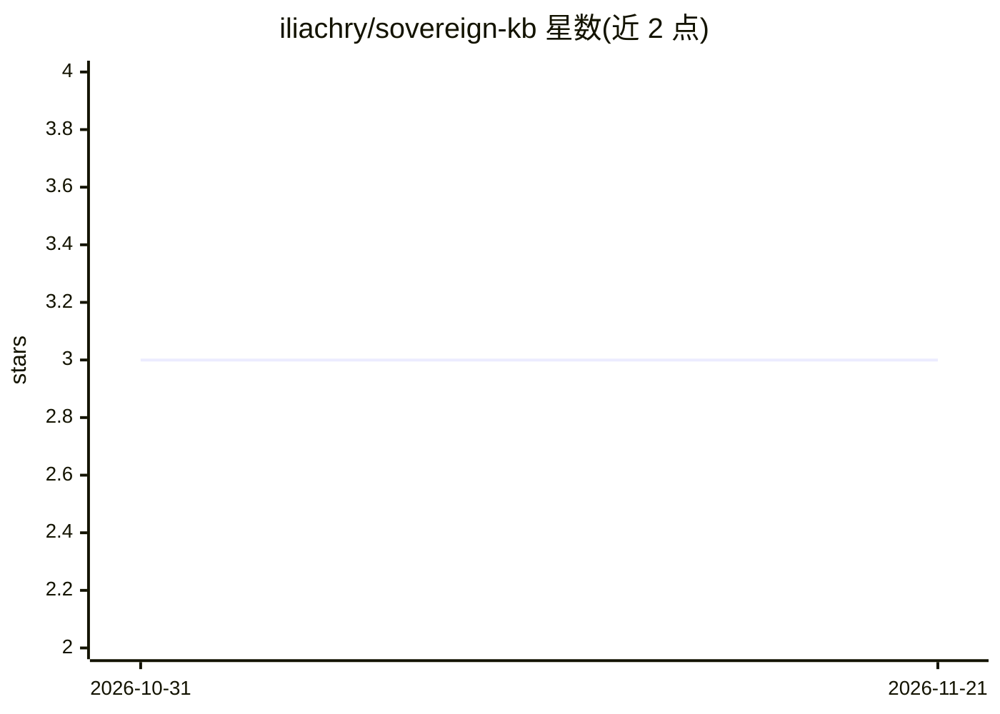

# iliachry/sovereign-kb

⭐ 3 · Python · MIT · 推送 2026-11-18 · [GitHub](https://github.com/iliachry/sovereign-kb) · [官网](https://iliachry.gr) · 个人维护

**为 AI 编码 agent 提供本地 Markdown 记忆与质量审计的 CLI 工具**

面向工程师与 AI 编码 agent 的本地优先 Markdown 记忆与审计工具集，包含 skb（4 路混合检索记忆库）、gwi（G>=9.0 质量门审计）、evr（RFC 6962 Merkle 证明胶囊）与 organon 统一 CLI。基于 Python 3.10+ 标准库与 SQLite FTS5，零运行时依赖，全部本地运行；支持 BM25+wikilink 图传播的混合检索，可选 Ollama 本地嵌入与 OpenAI 兼容端点做问答。多节点自主编排器 swm 为专有部分。

## 筛选速览

| 维度 | 判定 | 备注 |
|---|---|---|
| AI 角色 | `ai-ecosystem` | LLM/agent 周边工具 |
| 许可风险 | `permissive` | MIT |
| 部署形态 | `None` |  |
| 模型依赖 | local-ok | 支持本地模型 |
| 硬件要求 | — | 无带数字的原话,不猜 |
| 安装摩擦 | `low` | 无编译、无系统依赖或容器化 |
| 成熟度 | — | 结构信号不足 |

## 能力要点

- 本地 BM25+wikilink 图+可选 Ollama 嵌入的 4 路混合检索，--json 供 agent 调用
- RFC 6962 Merkle 证明与 .evr 零拷贝加密胶囊封装交付物
- G>=9.0 质量门审计软件、3D 仿真、论文与视频等多类对象
- 零运行时依赖，仅 Python 3.10+ 标准库与 SQLite FTS5，本地运行

## 适用场景

- 让 Claude Code/Cursor 等 agent 跨会话记住项目决策与上下文
- 在终端捕获架构决策并按主题检索过往记录
- 对代码仓库或论文运行质量门审计
- 对交付物做 Merkle 可验证性封装

## 场景标签

`Agent 记忆` `知识库管理` `语义搜索` · 领域:Agent 开发

## 证据(README 行号)

> L3: **Local-first Markdown memory, mathematical quality gating (`G >= 9.0`), and cryptographic artifact capsules for eng
> L10: Point `skb` at any folder of `.md` files—or initialize a fresh vault in one command. Capture architectural decision
> L12: Everything runs locally on **Python 3.10+ standard library + SQLite FTS5** with **zero runtime dependencies**. Dele

## 星数曲线

2026-10-31 3 → 2026-11-21 3（+0）

---
*卡片 v1 · prompt 1.4 · 生成 2026-11-21 · 置信度 high · 依据 README sha `956a8c138d75` · [字段定义](../../DATASET.md)*
