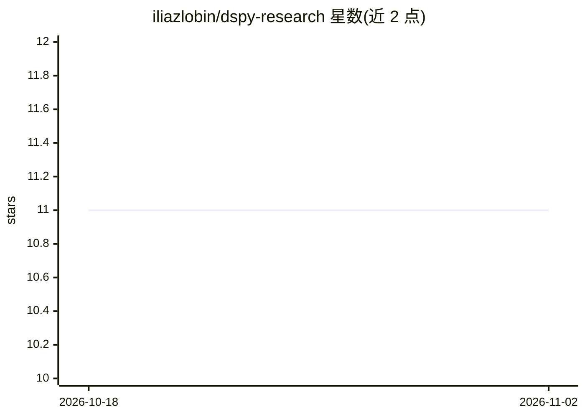

# iliazlobin/dspy-research

⭐ 11 · Jupyter Notebook · MIT · 推送 2026-06-24 · [GitHub](https://github.com/iliazlobin/dspy-research) · 个人维护

**DSPy 框架的实验与演示仓库：LLM 流水线的评估与编译笔记**

围绕 Stanford DSPy 框架的实践探索仓库：以 Jupyter 笔记本展示声明式签名、模块组合（Predict/ChainOfThought/ReAct/RAG）与 teleprompter 编译优化在三个任务上的应用——HumanEval 代码生成评测、公司估值结构化抽取、多阶段市场分析。各笔记本共用 OpenAI gpt-3.5-turbo 与 You.com 检索器，附系统设计图与 DSPy 论文镜像，需自备 API key，通过 git clone 运行。

## 筛选速览

| 维度 | 判定 | 备注 |
|---|---|---|
| AI 角色 | `ai-knowledge` | 知识聚合/清单类 |
| 许可风险 | `permissive` | MIT |
| 部署形态 | `None` |  |
| 模型依赖 | — | README 未给出锁定关系 |
| 硬件要求 | — | 无带数字的原话,不猜 |
| 安装摩擦 | `low` | 无编译、无系统依赖或容器化 |
| 成熟度 | — | 结构信号不足 |

## 能力要点

- 三个自包含实验笔记本：代码生成评测、公司估值、市场分析
- 演示 BootstrapFewShot 等编译优化与编译前后得分对比
- 进程隔离带超时的 Python REPL 沙箱运行模型生成代码
- 镜像 DSPy 基础论文并附系统架构图

## 适用场景

- 学习 DSPy 声明式流水线的编写、评估与编译
- 参考代码生成任务中 pass/fail 指标与沙箱执行的做法
- 了解从朴素流水线到多阶段编译系统的演进设计

## 场景标签

`提示工程` `模型评测` `RAG` `教程课程` · 领域:Agent 开发

## 证据(README 行号)

> L14: dataset and a metric. This repo collects the notebooks, diagrams, and reference papers used to evaluate
> L40: Each notebook is a self-contained experiment. They share a common setup — an OpenAI LM
> L111: The foundational DSPy papers are mirrored in `papers/`:

## 星数曲线

2026-10-18 11 → 2026-11-02 11（+0）

---
*卡片 v1 · prompt 1.4 · 生成 2026-11-02 · 置信度 high · 依据 README sha `27301120c591` · [字段定义](../../DATASET.md)*
