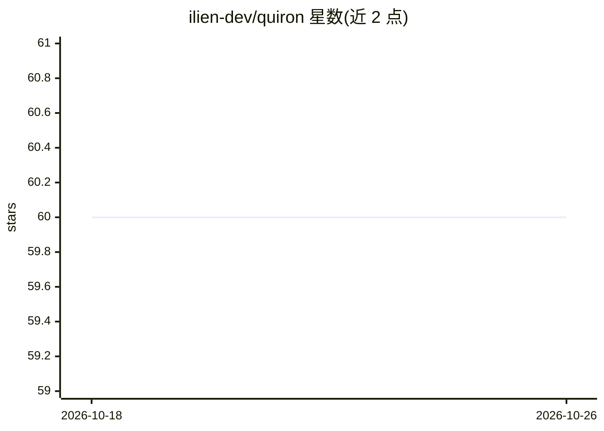

# ilien-dev/quiron

⭐ 60 · Python · AGPL-3.0 · 推送 2026-09-25 · [GitHub](https://github.com/ilien-dev/quiron) · [官网](https://quiron.ilien.dev/) · 个人维护

**给 Claude Code/Codex/Cursor 用户的 AI 文本人性化技能：去 AI 腔并量化测量**

以 agent skill 形式提供：交给它草稿后重写文本以去除 AI 写作痕迹（33 项模式清单），随后用 Python 3 脚本测量重写文本的 23 项比率并与人类写作基线（ChatGPT 出现前发表的 167 篇 dev.to 帖与 157 篇故事等）对比，给出数值判定。仅用 Python 3 标准库，无需 API key，运行在宿主 agent 已有模型上。限制：不能通过读取 token 概率的 AI 检测器；约 120 词以下文本不测量；非小说/西班牙语外的语言仅尽力给清单、无人类基线。

## 筛选速览

| 维度 | 判定 | 备注 |
|---|---|---|
| AI 角色 | `ai-native` | 本体是模型或模型工具 |
| 许可风险 | `viral` | AGPL-3.0 |
| 部署形态 | `library` | 以包/库形式分发 |
| 模型依赖 | locked-api |  |
| 硬件要求 | — | 无带数字的原话,不猜 |
| 安装摩擦 | `low` | 无编译、无系统依赖或容器化 |
| 成熟度 | — | 结构信号不足 |

## 能力要点

- 33 项 AI 写作模式清单加 23 项比率的量化测量表
- 人类基线来自 ChatGPT 出现前发表的文本集，四分之一留出未用于调参
- 区分 AI 侧偏移与『矫枉过正』两种失败模式
- factdiff.py 列出重写中出现而原文没有的数字与链接

## 适用场景

- 让内部文档、教程草稿读起来更像人写的
- 检查文本中的 AI 痕迹而不重写
- 对自己的写作样本做风格匹配改写

## 场景标签

`AI 写作` · 领域:内容生成

## 证据(README 行号)

> L7:  An agent skill for Claude Code, Codex and Cursor. It strips the AI slop that marks prose as machine-written,
> L17: ChatGPT. It rewrites the prose, then measures the result. You get the rewrite and a
> L79: $ python3 scripts/aimeter.py eval/ai/blog/e2e-raw/aspittel-782713.md

## 星数曲线

2026-10-18 60 → 2026-10-26 60（+0）

---
*卡片 v1 · prompt 1.4 · 生成 2026-10-24 · 置信度 high · 依据 README sha `b48a45ee7ef0` · [字段定义](../../DATASET.md)*
