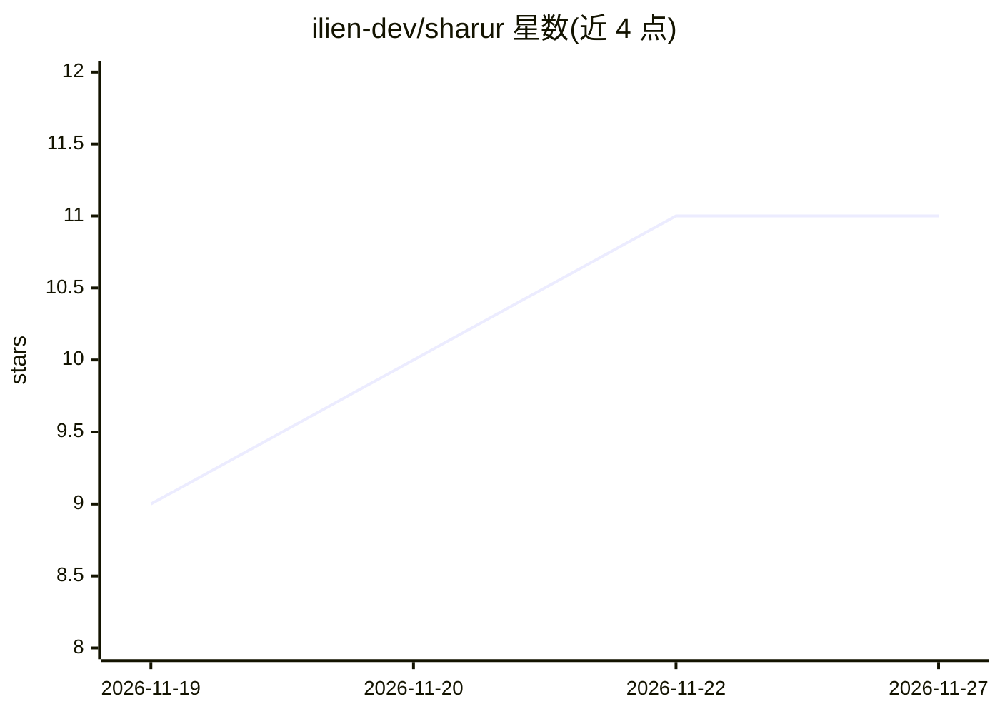

# ilien-dev/sharur

⭐ 11 · Python · MIT · 推送 2026-11-18 · [GitHub](https://github.com/ilien-dev/sharur) · 个人维护

**一行式输出风格文件：为 Claude Code 降低 token 用量与成本**

一个供 Claude Code 使用的 Markdown 输出风格文件，指示模型以电报式、不超过两行/25 词的格式回答，去除问候语与冗词，大结果按条目逐行输出。附 13 项任务的自建基准（每任务 3 次，取中位数），报告相对内置 Concise 风格的成本与输出 token 差异，并经隐藏测试核验代码正确性。安装方式为粘贴提示词或 curl 下载单个文件到 ~/.claude/output-styles/，无二进制、钩子、代理或遥测。基准仅测于 Opus 5.5，大任务节省幅度下降。

## 筛选速览

| 维度 | 判定 | 备注 |
|---|---|---|
| AI 角色 | `ai-ecosystem` | LLM/agent 周边工具 |
| 许可风险 | `permissive` | MIT |
| 部署形态 | `None` |  |
| 模型依赖 | — | README 未给出锁定关系 |
| 硬件要求 | — | 无带数字的原话,不猜 |
| 安装摩擦 | `low` | 无编译、无系统依赖或容器化 |
| 成熟度 | — | 结构信号不足 |

## 能力要点

- 单个 Markdown 文件即可安装，无二进制/钩子/代理/账号/遥测
- 附带 13 项任务、每任务 3 次的自建基准与可复现方法（BENCHMARKS.md）
- 对内建 Concise 风格给出逐任务的成本、输出 token 与阅读词数对比表
- 隐藏测试核验两种风格产出的文件均通过

## 适用场景

- 降低 Claude 订阅计划中每项编码任务的 token 消耗
- 缩短编码助手回复的阅读时间
- 为 Claude Code 更换输出风格而不改变工作流程

## 场景标签

`提示工程` `模型评测` · 领域:Agent 开发

## 证据(README 行号)

> L1: Sharur, an output style for Claude Code. Against Concise on Opus 5.5, everyday coding tasks cost 21% less and their 
> L7:  An output style for Claude Code that answers in one or two lines, with no greeting or filler,

## 星数曲线

2026-11-19 9 → 2026-11-27 11（+2）

---
*卡片 v1 · prompt 1.4 · 生成 2026-11-20 · 置信度 high · 依据 README sha `855650df5d6b` · [字段定义](../../DATASET.md)*
