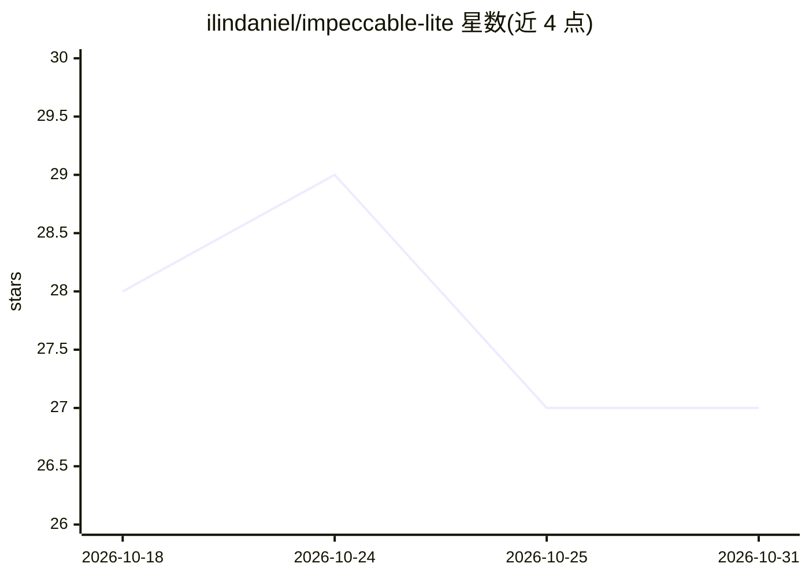

# ilindaniel/impeccable-lite

⭐ 27 · Apache-2.0 · 推送 2026-08-01 · [GitHub](https://github.com/ilindaniel/impeccable-lite) · 个人维护

**给编码 agent 的单一前端设计判断技能文件（SKILL.md）**

Impeccable 的独立精简衍生品：仅保留一个 SKILL.md 文件，内含前端设计判断层——视觉方向、营销/产品 UI/编辑/展示等设计模式、排版色彩布局交互动效指引、对泛化 AI 界面模式的约束、可访问性与响应式要求，以及受限的构建验证流程。去除了原版的插件、hooks、CLI、确定性检测与实时浏览器编辑等机制。安装方式为将 SKILL.md 手动放入各 agent 平台的技能目录，支持 Claude Code、Codex、Cursor 等 16 类平台；不支持 Agent Skills 的 agent 可将内容复制进项目指令作为回退。

## 筛选速览

| 维度 | 判定 | 备注 |
|---|---|---|
| AI 角色 | `ai-knowledge` | 知识聚合/清单类 |
| 许可风险 | `permissive` | Apache-2.0 |
| 部署形态 | `None` |  |
| 模型依赖 | — | README 未给出锁定关系 |
| 硬件要求 | — | 无带数字的原话,不猜 |
| 安装摩擦 | `low` | 无编译、无系统依赖或容器化 |
| 成熟度 | — | 结构信号不足 |

## 能力要点

- 单一 SKILL.md 文件，无插件/hooks/CLI/实时模式
- 保留 Impeccable 的设计判断层（视觉方向、设计模式、排版与可访问性指引）
- 列出 16 类 agent 平台的技能目录安装路径
- 提供复制进项目指令的回退加载方式

## 适用场景

- 让编码 agent 在生成 UI 时遵循一致的设计判断
- 在不引入插件机制的前提下为 agent 注入前端设计指引
- 跨多个 agent 平台复用同一份设计技能文件

## 场景标签

`提示工程` · 领域:Agent 开发

## 证据(README 行号)

> L3: One skill. No plugin, hooks, CLI, or live mode. Just design judgment.
> L5: Impeccable Lite is a distilled, independent derivative of Impeccable. It keeps the frontend design guidance and remo

## 星数曲线

2026-10-18 28 → 2026-10-31 27（-1）

---
*卡片 v1 · prompt 1.4 · 生成 2026-10-26 · 置信度 high · 依据 README sha `e1453831e214` · [字段定义](../../DATASET.md)*
