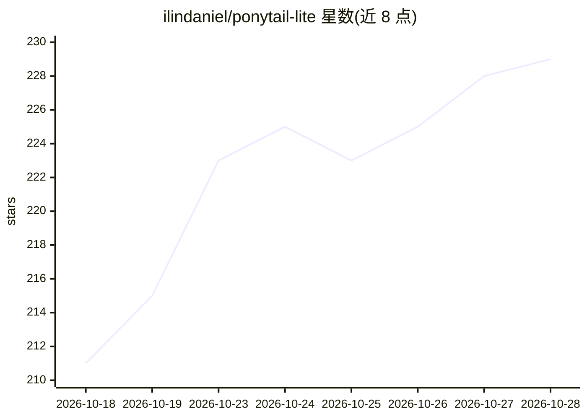

# ilindaniel/ponytail-lite

⭐ 229 · MIT · 推送 2026-07-26 · [GitHub](https://github.com/ilindaniel/ponytail-lite) · 个人维护

**单文件 AGENTS.md 规则：约束 AI agent 避免过度设计**

由单个 AGENTS.md 文件组成的 agent 行为规则包，是 Ponytail 插件的单文件独立版本，内容为对原版的改写而非逐字节复制。使用方式为将文件文本复制到各 coding agent 的项目指令/规则位置，README 列出 20 种 agent（Claude Code、Cursor、Codex、GitHub Copilot、Aider 等）的对应放置路径；卸载即删除该文件。核心机制是七层递进检查阶梯：写代码前依次确认必要性、已有实现、标准库、平台特性、已有依赖、能否一行解决，最后才写最少可用代码。MIT 许可。

## 筛选速览

| 维度 | 判定 | 备注 |
|---|---|---|
| AI 角色 | `ai-ecosystem` | LLM/agent 周边工具 |
| 许可风险 | `permissive` | MIT |
| 部署形态 | `None` |  |
| 模型依赖 | — | README 未给出锁定关系 |
| 硬件要求 | — | 无带数字的原话,不猜 |
| 安装摩擦 | `low` | 无编译、无系统依赖或容器化 |
| 成熟度 | — | 结构信号不足 |

## 能力要点

- 单文件交付，无插件/hooks/MCP/模式切换
- 七层“写最少代码”递进检查阶梯
- 覆盖 20 种 coding agent 的放置路径说明
- 卸载只需删除文件，无残留组件

## 适用场景

- 给我的 coding agent 加一条别过度设计的规则
- 在 Claude Code 或 Cursor 等工具中约束 agent 优先复用已有代码
- 不想装插件、只要一份指令文件来管住 agent 的行为

## 场景标签

`提示工程` · 领域:Agent 开发

## 证据(README 行号)

> L11: Just copy `AGENTS.md` into the place your agent reads instructions. That's it. No plugin, hooks, commands, MCP, or 
> L65: Before writing code, the agent climbs this ladder:

## 星数曲线

2026-10-18 211 → 2026-10-28 229（+18）

---
*卡片 v1 · prompt 1.4 · 生成 2026-10-22 · 置信度 high · 依据 README sha `2f38e3ab9af0` · [字段定义](../../DATASET.md)*
