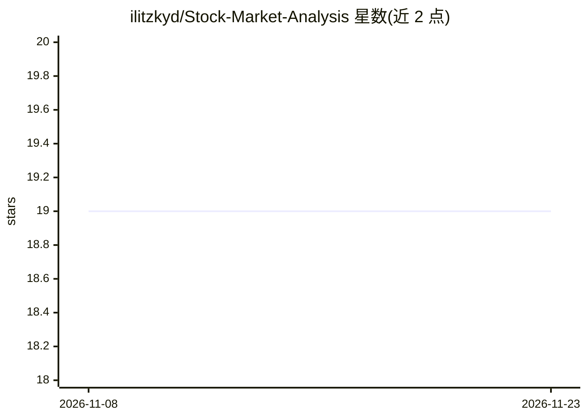

# ilitzkyd/Stock-Market-Analysis

⭐ 19 · Python · 推送 2026-11-04 · [GitHub](https://github.com/ilitzkyd/Stock-Market-Analysis) · 个人维护

**本地股票研究应用：价格预测、交易信号与宏观相关性分析**

本地运行的交互式股票研究 Web 应用，从 Yahoo Finance 拉取美股/ETF 历史数据，提供价格概览、Random Forest 与基线模型的预测对比（按交易日评估、验证折选模型）、RSI/布林带观测与明确的均值回归规则模拟、以及基于 FRED 数据的宏观指标相关性分析。默认合成演示数据，接入实时数据可切换，宏观实时分析需自备 FRED API key。声明为研究软件，不执行交易、不构成投资建议。

## 筛选速览

| 维度 | 判定 | 备注 |
|---|---|---|
| AI 角色 | `ai-native` | 本体是模型或模型工具 |
| 许可风险 | `none` | — |
| 部署形态 | `desktop` | 安装包/桌面程序 |
| 模型依赖 | — | README 未给出锁定关系 |
| 硬件要求 | — | 无带数字的原话,不猜 |
| 安装摩擦 | `low` | 无编译、无系统依赖或容器化 |
| 成熟度 | — | 结构信号不足 |

## 能力要点

- 三种预测模型（Last price/Log drift/Random Forest）按时间顺序交叉验证并保留测试期
- 明确的均值回归交易规则模拟：次日开盘执行、计入成本、输出权益曲线与交易台账
- FRED 宏观数据对齐观测月份的同期相关性分析，可选 vintage 日期
- 预测可导出 CSV、图表导出 PNG，离线单元测试覆盖核心逻辑

## 适用场景

- 对比预测模型在历史股票数据上的表现并查看误差区间
- 模拟带成本的均值回归交易规则并对比买入持有
- 结合宏观指标观察与股票回报的同期相关性
- 无需实盘即可研究美股/ETF 的历史表现与波动

## 场景标签

`金融量化` · 领域:学习与行业

## 证据(README 行号)

> L38: |Forecast|Last-price, log-drift, and Random Forest comparisons; validation/test scores; 5, 10, or 20 future trading
> L80: - **Random Forest:** directly predicts a vector of 20 future log returns using

## 星数曲线

2026-11-08 19 → 2026-11-23 19（+0）

---
*卡片 v1 · prompt 1.4 · 生成 2026-11-18 · 置信度 high · 依据 README sha `62356f1cb202` · [字段定义](../../DATASET.md)*
