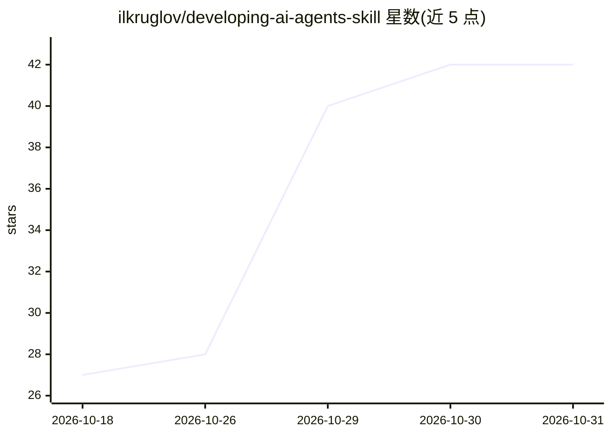

# ilkruglov/developing-ai-agents-skill

⭐ 42 · Python · Apache-2.0 · 推送 2026-09-30 · [GitHub](https://github.com/ilkruglov/developing-ai-agents-skill) · 个人维护

**基于 Bojie Li 著作的 AI 代理设计/调试/评测技能插件**

面向 Claude Code 与 Codex 的单一技能插件，用于辅助设计、排查与评估 AI 代理：内含 Bojie Li《AI-агенты изнутри》第二版的俄文全文、分章摘要（带逐字校验的引文与行号）、文档模板（代理设计、Harness 规格、工具契约、评测计划等）以及按症状组织的常见故障目录（16 条“故障→机制→检查”模式）。README 报告在 32 个任务上的自测结果（96% 对 84%），并明列测量局限（单次运行、单一模型等）。通过 claude/codex 插件市场命令安装，Apache 2.0 许可。

## 筛选速览

| 维度 | 判定 | 备注 |
|---|---|---|
| AI 角色 | `ai-knowledge` | 知识聚合/清单类 |
| 许可风险 | `permissive` | Apache-2.0 |
| 部署形态 | `None` |  |
| 模型依赖 | locked-api |  |
| 硬件要求 | — | 无带数字的原话,不猜 |
| 安装摩擦 | `low` | 无编译、无系统依赖或容器化 |
| 成熟度 | — | 结构信号不足 |

## 能力要点

- 包含书籍俄文全文与带行号引用的分章摘要
- 文档模板与 16 条“故障→机制→检查”故障模式目录
- 自动触发，也可在 Claude Code/Codex 中显式调用
- 脚本校验引文逐字性与行号锚点（validate.py）

## 适用场景

- 决定某任务需要代理还是单次模型调用/固定流程
- 排查代理循环、上下文丢失或重复调用工具的原因
- 为新提示词/模型/工具的改动设计评测与发布计划

## 场景标签

`模型评测` `教程课程` · 领域:评测与运维

## 证据(README 行号)

> L3: Плагин для Claude Code и Codex с одним скиллом, который помогает
> L90: - каталог типичных сбоев по симптомам и 16 паттернов «сбой → механизм →
> L92: - конспекты всех глав книги с проверенными цитатами и полный текст книги.

## 星数曲线

2026-10-18 27 → 2026-10-31 42（+15）

---
*卡片 v1 · prompt 1.4 · 生成 2026-10-26 · 置信度 high · 依据 README sha `a1e54c40e964` · [字段定义](../../DATASET.md)*
