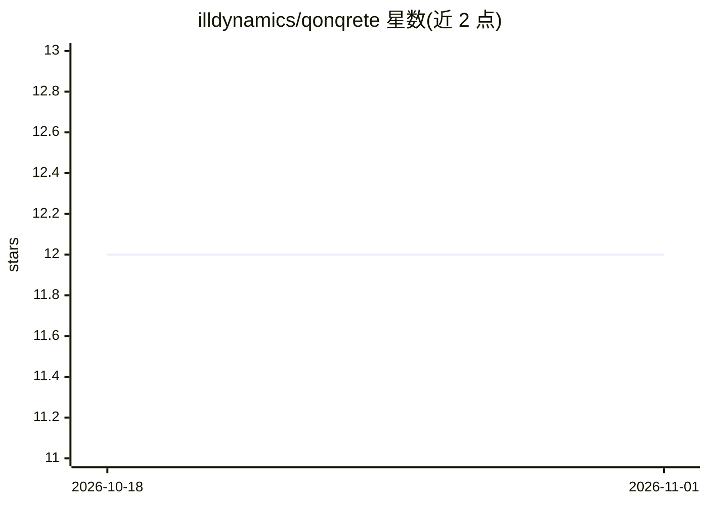

# illdynamics/qonqrete

⭐ 12 · Python · 推送 2026-09-14 · [GitHub](https://github.com/illdynamics/qonqrete) · [官网](https://qonqrete.sh) · 组织维护

**本地优先的多智能体 AI 编码流水线，读 Markdown 任务产出完整构建**

QonQrete 是文件驱动、本地优先的 AI 软件构建引擎：输入 Markdown 任务与目标目录，由 Qlarifier→instruQtor→construQtor↔inspeQtor 多智能体流水线完成澄清、规划（拆为 briqs）、生成、审查并循环迭代直至 FULLY_DONE。仓库含 qq CLI（Python）、VS Code 扩展、IntelliJ 插件、只读 kanban 网页面板 briQsQope 和本地浏览器 Chat。引擎自身不加载模型，通过 OpenAI 兼容端点对接外部服务：默认经 codeseeq CLI 使用 ChatGPT 账号登录，也可切换 DeepSeek，或指向独立运行的 llama.cpp（GGUF）/MLX（Apple Silicon）服务器实现离线推理；支持 WSL2 下自动检测 Windows 宿主端点。经 install.sh 或 curl 一键脚本安装，Rust TUI 需要 cargo（可选）。

## 筛选速览

| 维度 | 判定 | 备注 |
|---|---|---|
| AI 角色 | `ai-ecosystem` | LLM/agent 周边工具 |
| 许可风险 | `permissive` | — |
| 部署形态 | `None` |  |
| 模型依赖 | local-ok | 支持本地模型 |
| 硬件要求 | — | 无带数字的原话,不猜 |
| 安装摩擦 | `medium` | 含编译或系统依赖之一 |
| 成熟度 | — | 结构信号不足 |

## 能力要点

- clarify→plan→build→review 多智能体循环直至 FULLY_DONE
- 通过 OpenAI 兼容端点对接 ChatGPT 账号/DeepSeek/llama.cpp/MLX，引擎自身不加载模型
- 仓库同时提供 qq CLI、VS Code 扩展、IntelliJ 插件、briQsQope 网页面板与本地 Chat
- WSL2 下自动检测 Windows 宿主的 llama-server 端点

## 适用场景

- 把 Markdown 任务交给多智能体流水线一次完成规划、编码与审查
- 在 Apple Silicon 上用 MLX 或本地 llama.cpp 实现离线编码推理
- 在 VS Code / IntelliJ 内直接运行与配置编码任务

## 场景标签

`编码 Agent` `多智能体` · 领域:Agent 开发

## 证据(README 行号)

> L16: QonQrete is a **local-first, file-based, deterministic AI software construction harness**. You give it a Markdown t
> L121: For fully local, offline inference QonQrete points at an OpenAI-compatible

## 星数曲线

2026-10-18 12 → 2026-11-01 12（+0）

---
*卡片 v1 · prompt 1.4 · 生成 2026-11-01 · 置信度 high · 依据 README sha `43bddc9e78d6` · [字段定义](../../DATASET.md)*
