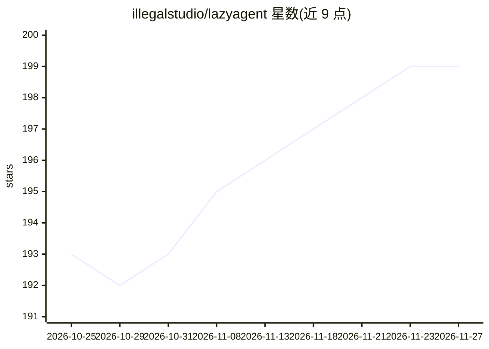

# illegalstudio/lazyagent

⭐ 199 · Go · MIT · 推送 2026-11-12 · [GitHub](https://github.com/illegalstudio/lazyagent) · [官网](https://lazyagent.dev/) · 组织维护

**从单一终端监控多个编码 agent 会话的 TUI/桌面应用**

以 TUI、macOS/Linux 桌面应用和 HTTP API 三种形式提供，集中查看 Claude Code、Cursor、Codex、Grok CLI 等九种编码 agent 的会话状态，不接管工作流、无需服务器与账号。附带会话维护命令：prune 清理过期会话文件、compact 压缩会话中的工具输出与图片、search 增量索引检索转录、limits 查看 Claude Code/Codex/Grok/Kimi/Cursor 的速率与用量摘要，并支持会话状态变化时的签名 webhook 推送。iOS 客户端为付费 App Store 应用，核心与 API 开源（MIT）。

## 筛选速览

| 维度 | 判定 | 备注 |
|---|---|---|
| AI 角色 | `ai-ecosystem` | LLM/agent 周边工具 |
| 许可风险 | `permissive` | MIT |
| 部署形态 | `library` | 以包/库形式分发 |
| 模型依赖 | — | README 未给出锁定关系 |
| 硬件要求 | — | 无带数字的原话,不猜 |
| 安装摩擦 | `low` | 无编译、无系统依赖或容器化 |
| 成熟度 | — | 结构信号不足 |

## 能力要点

- 统一监控 9 种编码 agent 的本地与 Cursor 云端会话
- prune/compact/search/limits 等会话清理、检索与用量命令
- 会话状态转换时发送签名 webhook 到 Slack/CI 等端点
- TUI、桌面应用、HTTP API 三种接口，MIT 开源

## 适用场景

- 在多个项目目录下并行运行不同编码 agent 时集中查看会话状态
- 定期清理和压缩历史 agent 会话文件以释放磁盘空间
- 查询 Claude Code、Codex 等工具的速率限制与用量节奏
- 基于 HTTP API 自建监控面板或客户端

## 场景标签

 · 领域:开发者工具/agent 监控

## 证据(README 行号)

> L14:  9 agents supported &middot; TUI + desktop app + HTTP API &middot; No server, no lock-in &middot; MIT
> L16:  A terminal UI, a macOS/Linux desktop app, and an HTTP API for monitoring all your coding agents from a single plac
> L17:  Watch sessions from Claude Code, Cursor, Codex, Grok CLI, Kilo, Kimi Code CLI, Amp, pi, and OpenCode — lazyagent d

## 星数曲线

2026-10-25 193 → 2026-11-27 199（+6）

---
*卡片 v1 · prompt 1.4 · 生成 2026-11-25 · 置信度 high · 依据 README sha `1c030b19581a` · [字段定义](../../DATASET.md)*
