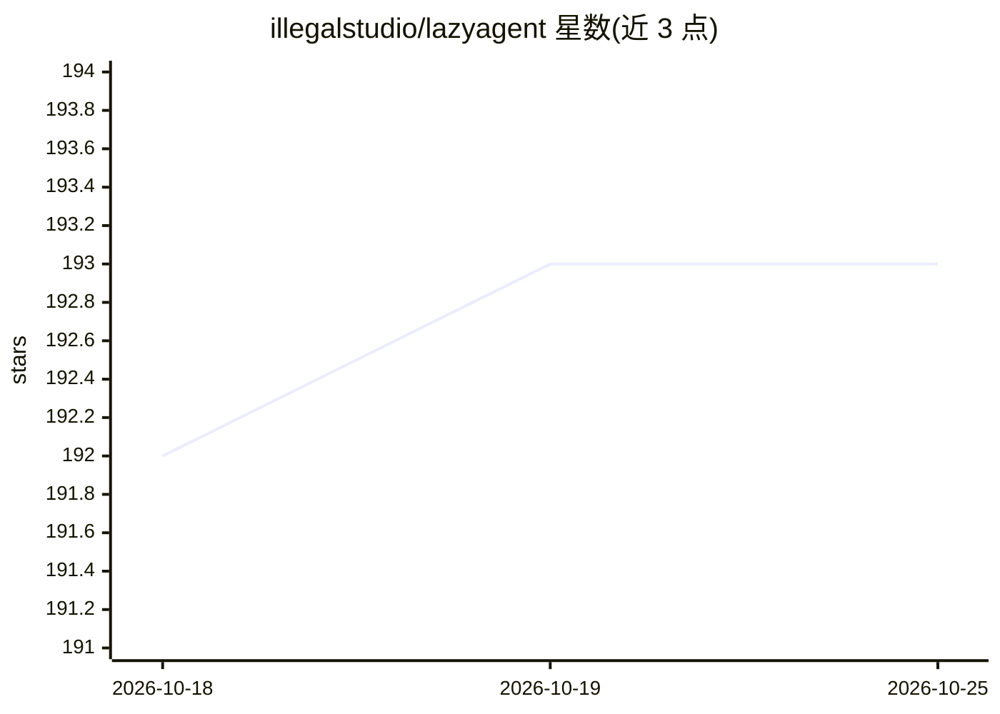

# illegalstudio/lazyagent

⭐ 193 · Go · MIT · 推送 2026-10-16 · [GitHub](https://github.com/illegalstudio/lazyagent) · [官网](https://lazyagent.dev/) · 组织维护

**单一终端监控 9 种编码 agent 的 TUI/桌面应用/HTTP API 工具**

Go 编写的编码 agent 监控工具：以终端 UI、macOS/Linux 桌面应用和 HTTP API 三种界面观察 Claude Code、Cursor、Codex、Grok CLI、Kimi 等 9 种 agent 的会话状态，不替换用户工作流仅旁观。附会话维护命令：prune 清理旧聊天文件、compact 压缩会话文件（截断工具输出/图片后仍可续跑）、search 本地索引搜索、limits 显示各家费率/账单用量。支持出站 webhook 在会话状态变化时推送签名 JSON。另有付费 iOS 客户端，核心与 API 开源（MIT）。

## 筛选速览

| 维度 | 判定 | 备注 |
|---|---|---|
| AI 角色 | `ai-ecosystem` | LLM/agent 周边工具 |
| 许可风险 | `permissive` | MIT |
| 部署形态 | `library` | 以包/库形式分发 |
| 模型依赖 | — | README 未给出锁定关系 |
| 硬件要求 | — | 无带数字的原话,不猜 |
| 安装摩擦 | `low` | 无编译、无系统依赖或容器化 |
| 成熟度 | — | 结构信号不足 |

## 能力要点

- TUI + macOS/Linux 桌面应用（DEB/RPM/Arch/AppImage）+ HTTP API 三种界面
- 监控 9 种编码 agent（Claude Code、Cursor、Codex、Grok CLI、Kimi、pi 等）
- prune/compact/search/limits 会话维护与费率用量命令，compact 后会话仍可续跑
- 会话状态变化的签名 webhook 推送（Slack/CI 端点）

## 适用场景

- 同时运行多个编码 agent 时在一个面板里查看全部会话
- 清理和压缩长期积累的 agent 会话文件、搜索历史记录
- 追踪 Claude Code/Codex 等的 rate-limit 与账单用量
- 会话空闲或等待输入时通过 webhook 通知 Slack 或 CI

## 场景标签

`LLM 可观测性` · 领域:评测与运维

## 证据(README 行号)

> L16:  A terminal UI, a macOS/Linux desktop app, and an HTTP API for monitoring all your coding agents from a single plac
> L17:  Watch sessions from Claude Code, Cursor, Codex, Grok CLI, Kilo, Kimi Code CLI, Amp, pi, and OpenCode — lazyagent d

## 星数曲线

2026-10-18 192 → 2026-10-25 193（+1）

---
*卡片 v1 · prompt 1.4 · 生成 2026-10-22 · 置信度 high · 依据 README sha `41176587f3b8` · [字段定义](../../DATASET.md)*
