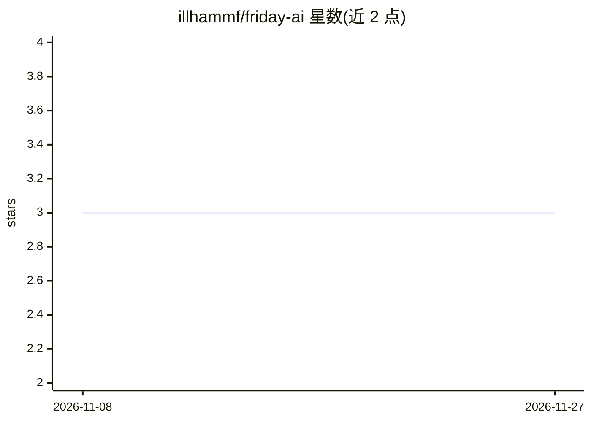

# illhammf/friday-ai

⭐ 3 · JavaScript · MIT · 推送 2026-11-26 · [GitHub](https://github.com/illhammf/friday-ai) · 个人维护

**连接 WhatsApp 的个人 AI 助手：聊天、识图、语音与生图**

基于 Node.js 与 whatsapp-web.js 的个人 WhatsApp 助手，接入 Google Gemini API。功能包括私聊/群聊对话（群聊需以机器人名开头唤起）、照片理解、文本生图、WebP 贴纸制作、语音留言转写与语音回复、TikTok/Instagram 视频下载，以及按显式请求管理的本地 SQLite 私人记忆。支持聊天与生图两条有序模型回退链。作为个人项目按现状提供，依赖非官方 WhatsApp Web 自动化库，行为可能随平台变更失效。

## 筛选速览

| 维度 | 判定 | 备注 |
|---|---|---|
| AI 角色 | `ai-native` | 本体是模型或模型工具 |
| 许可风险 | `permissive` | MIT |
| 部署形态 | `None` |  |
| 模型依赖 | — | README 未给出锁定关系 |
| 硬件要求 | — | 无带数字的原话,不猜 |
| 安装摩擦 | `medium` | 含编译或系统依赖之一 |
| 成熟度 | `idea` | |

## 能力要点

- 照片理解、文本生图、贴纸制作与语音留言转写/语音回复
- 聊天与生图分别配置有序模型回退链
- 本地 SQLite 私人记忆（每账号 30 条、拒绝保存密码/密钥类内容）
- npm run doctor 自检 Node 版本、API key、ffmpeg 与 yt-dlp

## 适用场景

- 在 WhatsApp 私聊中获得对话、识图与生图回复
- 群聊中以机器人名唤起进行问答
- 把图片转成 WhatsApp 贴纸
- 下载公开的 TikTok/Instagram 视频并转为 WhatsApp 兼容格式

## 场景标签

`AI 助手` `语音识别` `语音合成` · 领域:对话与助手

## 证据(README 行号)

> L3: Friday is a personal AI assistant for WhatsApp, built with Node.js, the
> L4: unofficial `whatsapp-web.js` library, and Google's Gemini API. It can chat,

## 星数曲线

2026-11-08 3 → 2026-11-27 3（+0）

---
*卡片 v1 · prompt 1.4 · 生成 2026-11-21 · 置信度 high · 依据 README sha `84e08a79bb38` · [字段定义](../../DATASET.md)*
