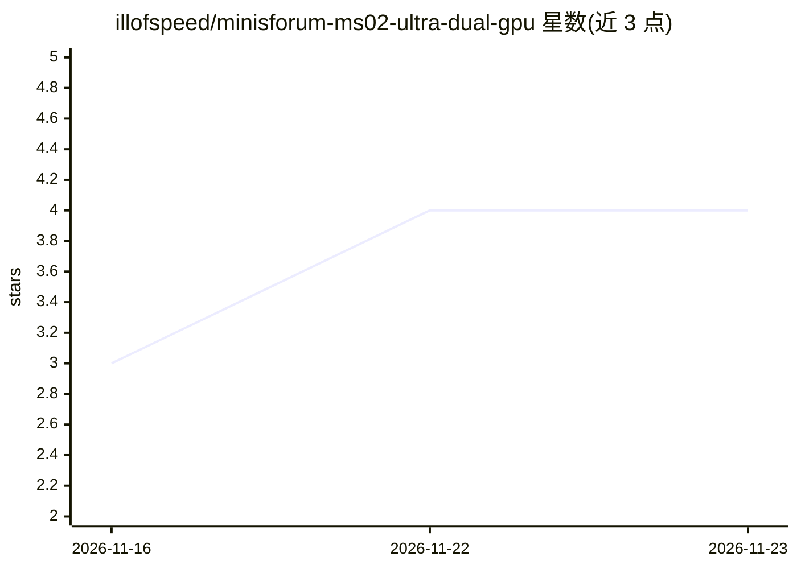

# illofspeed/minisforum-ms02-ultra-dual-gpu

⭐ 4 · Shell · GPL-3.0 · 推送 2026-10-13 · [GitHub](https://github.com/illofspeed/minisforum-ms02-ultra-dual-gpu) · 个人维护

**MS-02 Ultra 双 Blackwell GPU 装机笔记与本地 LLM 基准**

一份硬件装机与配置记录：在 Minisforum MS-02 Ultra（Core Ultra 9 285HX，192 GB 内存）原生电源上安装两张 70 W 单槽散热的 Blackwell 工作站 GPU，运行 Proxmox 并在 LXC 容器中跑本地 LLM。内容包括硬件清单、BIOS 与 Proxmox 主机设置（GPU 设备绑定脚本、AER 日志抑制、SSD 散热改造）、2 小时全负载测试（0 请求错误）以及各卡的逐模型 prefill/decode 基准数据；同时记录限制：顶仓卡高温、双卡拆分模型时并发请求报引擎错误。

## 筛选速览

| 维度 | 判定 | 备注 |
|---|---|---|
| AI 角色 | `ai-knowledge` | 知识聚合/清单类 |
| 许可风险 | `viral` | GPL-3.0 |
| 部署形态 | `None` |  |
| 模型依赖 | local-ok | 支持本地模型 |
| 硬件要求 | `cpu-ok` | |
| 安装摩擦 | `low` | 无编译、无系统依赖或容器化 |
| 成熟度 | — | 结构信号不足 |

## 能力要点

- 双 70 W Blackwell GPU 在原生电源上完成 2 小时全负载测试（0 请求错误）
- gpu-pin.sh 按型号将 /dev/nvidiaN 绑定到对应 LXC 容器
- Strata 引擎单卡与双卡自动拆分的 prefill/decode 基准数据
- 逐模型 decode/prefill 吞吐表（Ollama，8 个模型配置）

## 适用场景

- 在迷你主机上规划双 GPU 本地 LLM 部署的供电与散热方案
- 参考 Proxmox LXC 的 GPU 直通与设备绑定配置
- 对照单卡/双卡拆分推理的吞吐数据做硬件选型

## 场景标签

 · 领域:硬件装机/本地推理基础设施

## 证据(README 行号)

> L4: running Proxmox with local LLMs in LXC containers.** Build notes, the settings that mattered, a 2-hour load test and
> L139: **The layout I kept:** a large MoE model on the 24 GB card and a smaller "lookup" model on the 16 GB card, each in
> L143: **Large model:** Qwen3.8-Flash-Next in 2-bit (IQ2_XS) on the Strata engine 0.1.39. Strata keeps hot experts in VRA

## 星数曲线

2026-11-16 3 → 2026-11-23 4（+1）

---
*卡片 v1 · prompt 1.4 · 生成 2026-11-21 · 置信度 high · 依据 README sha `f58814aae382` · [字段定义](../../DATASET.md)*
