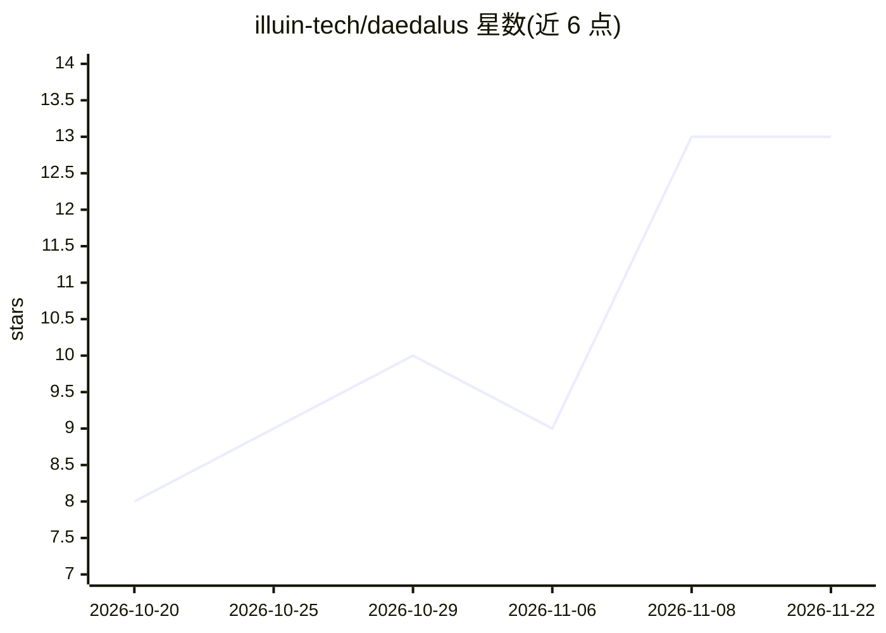

# illuin-tech/daedalus

⭐ 13 · Python · MIT · 推送 2026-10-19 · [GitHub](https://github.com/illuin-tech/daedalus) · [官网](https://illuin-tech.github.io/daedalus/) · 组织维护

**研究者复现 DAEDALUS：自生成任务为 agent 构建可复用记忆**

论文配套研究代码库，实现 DAEDALUS 方法：explorer 自生成难度可控的任务，solver 尝试执行，失败经验转化为启发式并在多次成功验证后写入记忆库，供 agent 在新环境中复用。支持 AppWorld、τ²-bench、AutomationBench 三个基准（git 子模块固定到论文 commit），提供生成/推理/消融/绘图等命令行入口，论文全部运行产物（任务、轨迹、启发式库、成本账本）发布于 Hugging Face 数据集，并附带本地 run 浏览器。模型调用经 litellm，需 API key，产生付费调用。

## 筛选速览

| 维度 | 判定 | 备注 |
|---|---|---|
| AI 角色 | `ai-ecosystem` | LLM/agent 周边工具 |
| 许可风险 | `permissive` | MIT |
| 部署形态 | `None` |  |
| 模型依赖 | — | README 未给出锁定关系 |
| 硬件要求 | — | 无带数字的原话,不猜 |
| 安装摩擦 | `low` | 无编译、无系统依赖或容器化 |
| 成熟度 | — | 结构信号不足 |

## 能力要点

- 无训练任务、无 oracle verifier 的 agent 记忆构建流程
- AppWorld/τ²-bench/AutomationBench 连接器与复现配置
- 论文全部产物发布于 Hugging Face 数据集 illuin/daedalus-traces
- 本地 run 浏览器展示分数、成本与逐轮轨迹

## 适用场景

- 复现论文实验并检查逐任务轨迹与成本
- 在自己的 agent 基准上生成启发式记忆库
- 研究对比 references/ 中的记忆基线方法

## 场景标签

`Agent 记忆` `科研工具` · 领域:Agent 开发

## 证据(README 行号)

> L17: - **DAEDALUS** builds them a reusable memory with *no training tasks and no oracle verifier*: an explorer invents t
> L126: |`daedalus/core/`|config, LLM client, memory, retrieval, generation pipeline, evaluation, cost ledger, prompts|`pr
> L129: |`references/`|the Table 1 baselines: ExpeL, ERL, AutoGuide, ReasoningBank, ACE, PREPING|`README.md`: how to run t

## 星数曲线

2026-10-20 8 → 2026-11-22 13（+5）

---
*卡片 v1 · prompt 1.4 · 生成 2026-11-18 · 置信度 high · 依据 README sha `9624c94c6b3f` · [字段定义](../../DATASET.md)*
