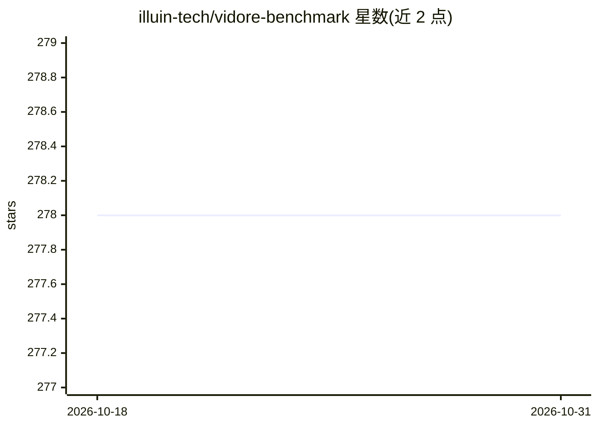

# illuin-tech/vidore-benchmark

⭐ 278 · Python · MIT · 推送 2026-10-20 · [GitHub](https://github.com/illuin-tech/vidore-benchmark) · [官网](https://huggingface.co/vidore) · 组织维护

**视觉文档检索评测框架：评测 ViDoRe v3 端到端检索管线**

ViDoRe 基准的评测代码库，现聚焦管线评测：通过继承 BasePipeline 实现 index() 与 search() 方法，评测多阶段检索、混合检索、含 OCR 预处理等端到端系统在 ViDoRe v3 数据集（HR、金融、工业、制药等 8 个领域）上的表现，使用 pytrec_eval 计算检索指标并跟踪索引/检索耗时。单模型检索器评测已迁移至 MTEB，旧功能仅保留可复现性并标记弃用。以 pip 包与 CLI 提供，兼作社区结果提交仓库。

## 筛选速览

| 维度 | 判定 | 备注 |
|---|---|---|
| AI 角色 | `ai-ecosystem` | LLM/agent 周边工具 |
| 许可风险 | `permissive` | MIT |
| 部署形态 | `library` | 以包/库形式分发 |
| 模型依赖 | — | README 未给出锁定关系 |
| 硬件要求 | — | 无带数字的原话,不猜 |
| 安装摩擦 | `low` | 无编译、无系统依赖或容器化 |
| 成熟度 | — | 结构信号不足 |

## 能力要点

- BasePipeline 抽象类支持自定义 index()/search() 管线评测
- 8 个 ViDoRe v3 数据集（HR/金融/工业/制药/物理等，含英/法双语）
- 基于 pytrec_eval 的检索指标计算与自定义指标支持
- 可选的附加指标跟踪（成本/耗时/资源）

## 适用场景

- 评测自建检索+重排等多阶段管线在 ViDoRe v3 上的表现
- 将管线评测结果提交到社区排行榜
- 在多种领域文档数据集上对比不同检索方案

## 场景标签

`模型评测` · 领域:评测与运维

## 证据(README 行号)

> L14: > This repository is now focused on **pipeline evaluation** for visual document retrieval tasks.
> L39: Pipeline evaluation allows you to evaluate **complete end-to-end retrieval systems** on the ViDoRe v3 benchmark dat
> L220: 3. **Evaluator**: Uses `pytrec_eval` to compute retrieval metrics

## 星数曲线

2026-10-18 278 → 2026-10-31 278（+0）

---
*卡片 v1 · prompt 1.4 · 生成 2026-10-22 · 置信度 high · 依据 README sha `cfdddee9ea93` · [字段定义](../../DATASET.md)*
