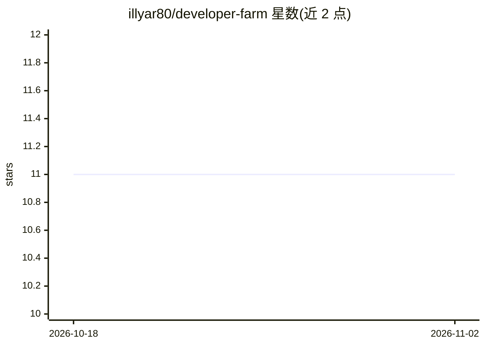

# illyar80/developer-farm

⭐ 11 · Python · MIT · 推送 2026-06-05 · [GitHub](https://github.com/illyar80/developer-farm) · 个人维护

**带架构隔离的自主 AI 编码流水线：从规格生成代码**

基于 LangGraph 构建的自主 AI 开发流水线，从用户规格说明生成代码。核心机制是 4 层架构隔离（规划、执行、验证等层间通过 TypedDict 限制信息流），使执行代理无法看到验收标准与测试，以架构方式应对 Goodhart 定律式的指标博弈。模型经 10 级路由在本地 Ollama（Qwen2.5-Coder-7B Q4_K_M）与 OpenRouter 免费层之间调度；使用 Git Worktrees 隔离工作分支，并带重试循环与 Kubernetes 风格自恢复控制回路。需 Python 3.11+、NVIDIA GPU 4GB+ VRAM 与 16GB RAM，源码 clone 安装。消融实验显示隔离提升对抗性得分但降低标准得分。

## 筛选速览

| 维度 | 判定 | 备注 |
|---|---|---|
| AI 角色 | `ai-native` | 本体是模型或模型工具 |
| 许可风险 | `permissive` | MIT |
| 部署形态 | `None` |  |
| 模型依赖 | local-ok | 支持本地模型 |
| 硬件要求 | `gpu-8g` | |
| 安装摩擦 | `low` | 无编译、无系统依赖或容器化 |
| 成熟度 | — | 结构信号不足 |

## 能力要点

- 4 层 TypedDict 隔离，执行层不可见验收标准与测试
- 10 级模型路由，本地 Ollama 与 OpenRouter 免费层混合
- Git Worktrees 按任务隔离分支与自恢复控制回路
- 本地可在 GTX 1050 Ti (4GB VRAM) + 16GB RAM 上运行

## 适用场景

- 我想让 AI 从规格说明自动生成代码且不针对测试作弊
- 在消费级硬件上零成本运行自主编码代理
- 对比隔离式与非隔离式验证的实验研究

## 场景标签

`编码 Agent` · 领域:编码与开发

## 证据(README 行号)

> L9: Autonomous AI development pipeline that generates code from specifications with **architectural guarantees against m
> L26: **Developer Farm** makes metric gaming **physically impossible** through strict 4-layer isolation:
> L51: - **Model Router**: 10-tier routing (local_small → cloud_ollama → openrouter) with deterministic scoring + LLM-assi

## 星数曲线

2026-10-18 11 → 2026-11-02 11（+0）

---
*卡片 v1 · prompt 1.4 · 生成 2026-11-02 · 置信度 high · 依据 README sha `b9443e318337` · [字段定义](../../DATASET.md)*
