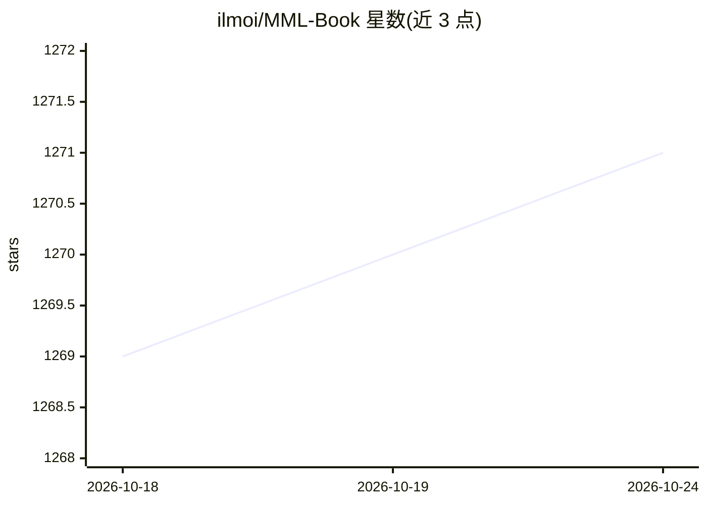

# ilmoi/MML-Book

⭐ 1,271 · Jupyter Notebook · 推送 2026-09-30 · [GitHub](https://github.com/ilmoi/MML-Book) · 个人维护

**《Mathematics for Machine Learning》自学代码与章节习题解答集**

围绕 MML（Mathematics for Machine Learning）一书整理的自学仓库：包含作者为理解书中概念而编写的 Python 代码（如混合高斯），以及第 2 至 7 章习题的解答，以 Notebook 与 PDF 两种形式提供；Notebook 渲染 LaTeX 需要一定时间。另有杂项内容文件夹。适合按书自学的读者参考对照，不提供安装或运行指引。

## 筛选速览

| 维度 | 判定 | 备注 |
|---|---|---|
| AI 角色 | `ai-knowledge` | 知识聚合/清单类 |
| 许可风险 | `none` | — |
| 部署形态 | `None` |  |
| 模型依赖 | — | README 未给出锁定关系 |
| 硬件要求 | — | 无带数字的原话,不猜 |
| 安装摩擦 | `low` | 无编译、无系统依赖或容器化 |
| 成熟度 | — | 结构信号不足 |

## 能力要点

- 第 2-7 章习题解答，Notebook 与 PDF 两种形式
- 作者自学过程中编写的概念理解 Python 代码（含混合高斯）

## 适用场景

- 自学 MML 教材时对照参考习题解答
- 查看书中数学概念的 Python 实现示例

## 场景标签

`教程课程` · 领域:学习与行业

## 证据(README 行号)

> L1: # Mathematics for Machine Learning (MML Book) - my Self Study
> L9: Solutions to exercises for each chapter. Notebooks might take a bit of time to render all the LaTeX.

## 星数曲线

2026-10-18 1,269 → 2026-10-24 1,271（+2）

---
*卡片 v1 · prompt 1.4 · 生成 2026-10-21 · 置信度 high · 依据 README sha `a05c2c14a8a3` · [字段定义](../../DATASET.md)*
