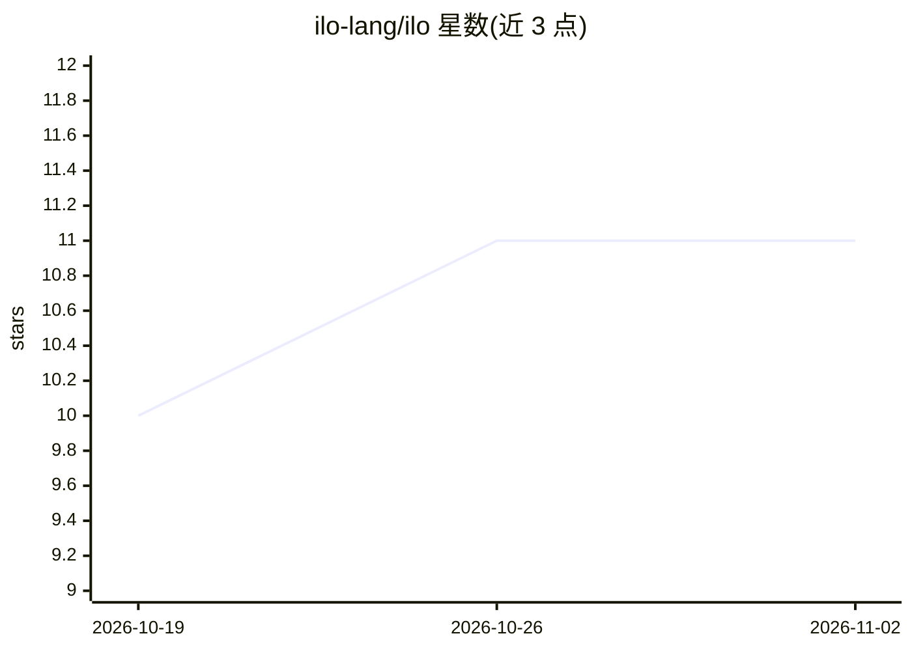

# ilo-lang/ilo

⭐ 11 · Rust · MIT · 推送 2026-10-09 · [GitHub](https://github.com/ilo-lang/ilo) · [官网](https://ilo-lang.ai) · 个人维护

**供 AI agent 编写的 token 精简编程语言（解释器+编译器）**

ilo 是一门面向 AI agent 而非人类编写的编程语言，名称来自 Toki Poni 的“工具”。采用前缀记法与位置参数以降低 token 与字符量，执行前做类型校验，错误以单 token 代码（如 ILO-T004）输出。由 Rust 实现，提供 AOT/Cranelift JIT/VM 三种执行路径、WASM 模式、JS 编译目标，标准库覆盖数学/统计/线性代数/HTTP/并行等。以 Agent Skill 形式分发给 Claude Code 等兼容 agent，自述为 pre 1.0 实验阶段，采用 CalVer 版本号。

## 筛选速览

| 维度 | 判定 | 备注 |
|---|---|---|
| AI 角色 | `ai-ecosystem` | LLM/agent 周边工具 |
| 许可风险 | `permissive` | MIT |
| 部署形态 | `library` | 以包/库形式分发 |
| 模型依赖 | — | README 未给出锁定关系 |
| 硬件要求 | — | 无带数字的原话,不猜 |
| 安装摩擦 | `low` | 无编译、无系统依赖或容器化 |
| 成熟度 | `idea` | |

## 能力要点

- 前缀记法+类型校验：声称 0.33× token、0.22× 字符，执行前捕获类型错误
- AOT / Cranelift JIT / VM 三种执行路径，另有 WASM（仅解释器）与 JS 编译目标
- 标准库含线性代数（matmul/fft/solve）、并发 HTTP（get-many）、par-map 并行、tokcount 内置 token 计数
- 以 Agent Skill 插件形式安装进 Claude Code 等兼容 agent，`ilo -ai` 输出供 LLM 的精简 spec

## 适用场景

- 让 AI agent 用更少 token 编写并运行小型程序
- 在 agent 工作流中执行类型校验过的数据管道与计算任务
- 通过 npx 免安装试用 ilo 单行程序

## 场景标签

 · 领域:编程语言/开发工具

## 证据(README 行号)

> L3: *A programming language AI agents write, not humans. Named from Toki Pona for "tool".*
> L20: AI agents pay three costs per program: generation tokens, error feedback, retries. ilo cuts all three:
> L222: ilo ships as an Agent Skill. Install the plugin and the agent learns ilo automatically.

## 星数曲线

2026-10-19 10 → 2026-11-02 11（+1）

---
*卡片 v1 · prompt 1.4 · 生成 2026-11-02 · 置信度 high · 依据 README sha `eddf636de92c` · [字段定义](../../DATASET.md)*
