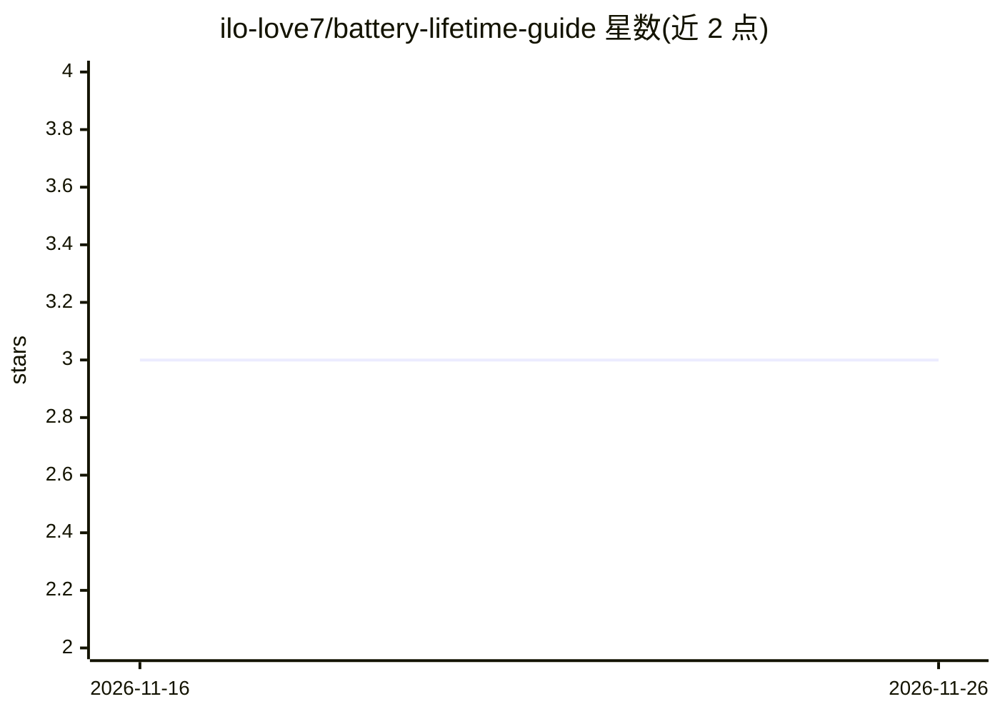

# ilo-love7/battery-lifetime-guide

⭐ 3 · Python · MIT · 推送 2026-11-21 · [GitHub](https://github.com/ilo-love7/battery-lifetime-guide) · 个人维护 · 中文 README

**复现 Severson 2019 电池寿命预测的中文学习攻略库**

以攻略形式复现 Severson et al. 2019（Nature Energy）电池循环寿命预测：官方 test_ind 口径下弹性网模型达到 5.9% 中位百分比误差，并给出 33.6%→5.9% 的误差归因链。面向学习者、复现者与求职者，提供 13 篇中文文档、可运行脚本、16 个离线测试与 CI。原创拓展包括 NASA 34 颗电池标签审计、零样本跨数据集迁移、域间隙四实验与 Kaplan–Meier 生存分析。复现路线需自备 MIT-Stanford 与 NASA 数据集。

## 筛选速览

| 维度 | 判定 | 备注 |
|---|---|---|
| AI 角色 | `ai-knowledge` | 知识聚合/清单类 |
| 许可风险 | `permissive` | MIT |
| 部署形态 | `library` | 以包/库形式分发 |
| 模型依赖 | — | README 未给出锁定关系 |
| 硬件要求 | `cpu-ok` | |
| 安装摩擦 | `low` | 无编译、无系统依赖或容器化 |
| 成熟度 | — | 结构信号不足 |

## 能力要点

- 官方 test_ind 口径弹性网复现达 5.9% 中位误差（bootstrap CI 5.1–8.9）
- 13 篇中文攻略文档含调试实录与 30 张面试问答卡
- NASA 34 颗电池逐一标签审计（仅 3/34 标签成立）
- protocol_drift 模块提供 KS 漂移检验与分位对齐诊断

## 适用场景

- 作为 Severson 2019 的参考实现，对照自己的复现结果
- 在采用公开电池数据集前按清单审计标签质量
- 作为电池数据课程的教学材料或求职作品集路线

## 场景标签

`教程课程` `模型评测` `科研工具` · 领域:评测与运维

## 证据(README 行号)

> L17: **This is a guide-style repository. The main text — 13 documents covering theory, reproduction, a debugging log and
> L53: (3) **teaching material** for a battery-data course — 13 Chinese documents with hands-on exercises at every stage;
> L103: |**Here to learn the method**|Follow stages 1→5, each with intuition building and hands-on exercises|`docs/00_怎么用这

## 星数曲线

2026-11-16 3 → 2026-11-26 3（+0）

---
*卡片 v1 · prompt 1.4 · 生成 2026-11-21 · 置信度 high · 依据 README sha `fbd8f9510d7a` · [字段定义](../../DATASET.md)*
