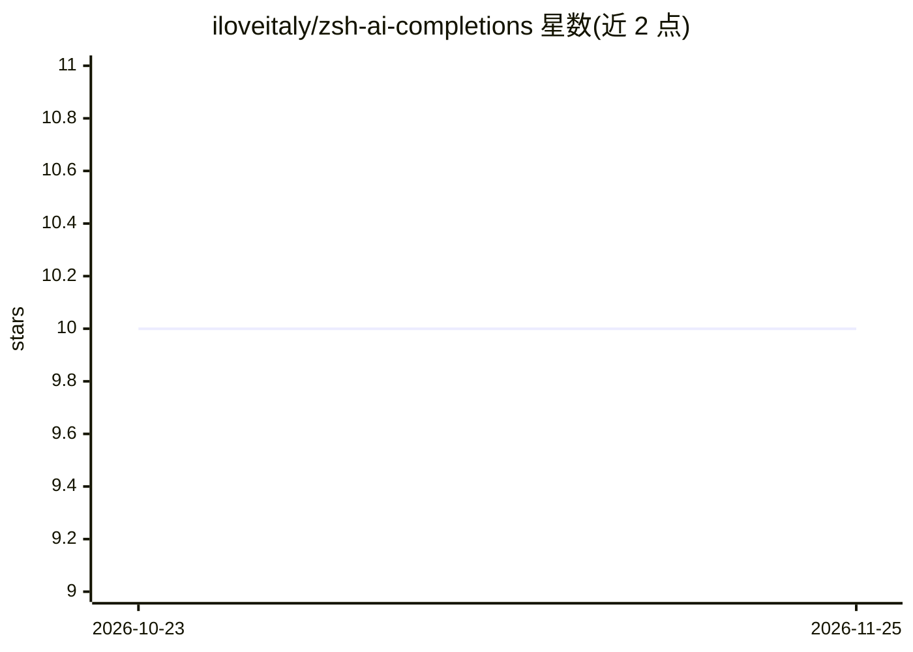

# iloveitaly/zsh-ai-completions

⭐ 10 · Python · MIT · 推送 2026-11-22 · [GitHub](https://github.com/iloveitaly/zsh-ai-completions) · [官网](https://github.com/iloveitaly/zsh-ai-completions) · 个人维护

**为 zsh 用户提供 AI 生成的命令行补全脚本**

一个 zsh 插件，收录用 AI 生成的命令补全脚本，通过 zinit 安装加载。生成流程以共享指令文件为基础，可按命令添加自定义 prompt 追加到默认提示词，生成器可通过环境变量选择（默认 grok，可选 agy）。作者以 zsh-completion-generator 为替换目标，称其已停止维护且不支持特定 Python CLI 库的 usage 信息。社区可通过 justfile 修改后提交 PR 扩充补全。

## 筛选速览

| 维度 | 判定 | 备注 |
|---|---|---|
| AI 角色 | `ai-native` | 本体是模型或模型工具 |
| 许可风险 | `permissive` | MIT |
| 部署形态 | `None` |  |
| 模型依赖 | locked-api |  |
| 硬件要求 | — | 无带数字的原话,不猜 |
| 安装摩擦 | `low` | 无编译、无系统依赖或容器化 |
| 成熟度 | — | 结构信号不足 |

## 能力要点

- 通过 zinit 一行命令安装
- 生成器可切换：环境变量选择 grok 或 agy
- 支持 per-command 自定义 prompt 文件追加到默认提示词
- justfile 工作流生成与测试单个补全

## 适用场景

- 给缺少补全的 CLI 工具快速补上 zsh 补全
- 为 help 文本无法覆盖的命令特性编写定制生成提示
- 社区协作扩充补全脚本集合

## 场景标签

`代码生成` · 领域:编码与开发

## 证据(README 行号)

> L10: zinit light iloveitaly/zsh-ai-completions
> L31: Set `ZSH_AI_CLI` to choose the generator (`grok` default, or `agy`).

## 星数曲线

2026-10-23 10 → 2026-11-25 10（+0）

---
*卡片 v1 · prompt 1.4 · 生成 2026-11-19 · 置信度 high · 依据 README sha `bf637554a0ec` · [字段定义](../../DATASET.md)*
