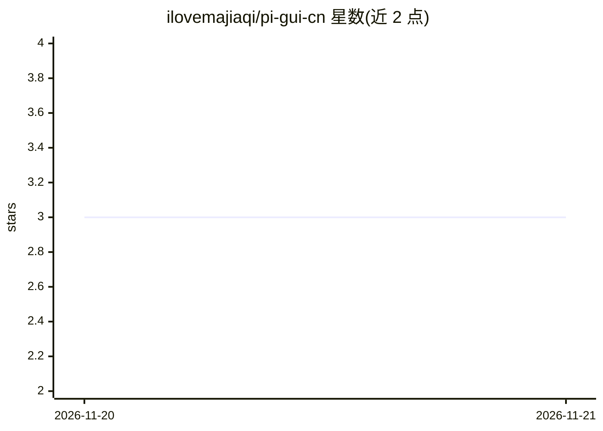

# ilovemajiaqi/pi-gui-cn

⭐ 3 · TypeScript · MIT · 推送 2026-11-17 · [GitHub](https://github.com/ilovemajiaqi/pi-gui-cn) · [官网](https://ilovemajiaqi.github.io/pi-gui-cn/) · 组织维护 · 中文 README

**pi coding agent 桌面客户端的完整简体中文本地化版**

本仓库是社区维护的 pi-gui（pi 编码代理的 Codex 风格桌面客户端）非官方简体中文版，与上游无隶属关系，跟随上游版本同步。本地化通过上游自研 locale catalog 源码级接入，覆盖侧边栏、会话时间线、命令面板、设置、终端、扩展、定时任务等界面，并经 IPC 通道使原生菜单、更新对话框与系统通知跟随语言切换；以 TS AST 门禁防止硬编码英文回退。此外做了若干 Windows 兼容性修复与质量门禁，不改变 pi 运行时行为；会话数据与上游版兼容（存于 ~/.pi）。

## 筛选速览

| 维度 | 判定 | 备注 |
|---|---|---|
| AI 角色 | `ai-ecosystem` | LLM/agent 周边工具 |
| 许可风险 | `permissive` | MIT |
| 部署形态 | `desktop` | 安装包/桌面程序 |
| 模型依赖 | — | README 未给出锁定关系 |
| 硬件要求 | — | 无带数字的原话,不猜 |
| 安装摩擦 | `low` | 无编译、无系统依赖或容器化 |
| 成熟度 | — | 结构信号不足 |

## 能力要点

- 全界面简体中文，Settings 内中英即时切换且缺失词条回退英文
- 原生菜单、更新对话框与系统通知通过 locale IPC 跨进程跟随语言
- TS AST 翻译防回退门禁与半角标点检查脚本
- 修复多个 Windows 下的真实缺陷并新增 Windows CI 车道

## 适用场景

- 中文环境下使用 pi coding agent 的桌面客户端
- Windows 上使用 pi-gui 并获得兼容性修复
- 参与界面翻译补充与本地化质量维护

## 场景标签

`编码 Agent` · 领域:编码与开发

## 证据(README 行号)

> L18: pi-gui 是 pi 编码代理（Codex 风格）的桌面图形客户端。本仓库在上游架构内完成了**全界面、真切换**的简体中文本地化：
> L48: pi-gui 本体功能（并行会话线程、git worktree 隔离、变更审查、内置终端、定时任务、技能/扩展管理等）见上游 README。本仓库新增：
> L165: - **维护模式**：以本地化、兼容性修复和上游同步为主，不改变 `pi` 运行时行为。

## 星数曲线

2026-11-20 3 → 2026-11-21 3（+0）

---
*卡片 v1 · prompt 1.4 · 生成 2026-11-21 · 置信度 mid · 依据 README sha `30511045c7d0` · [字段定义](../../DATASET.md)*
