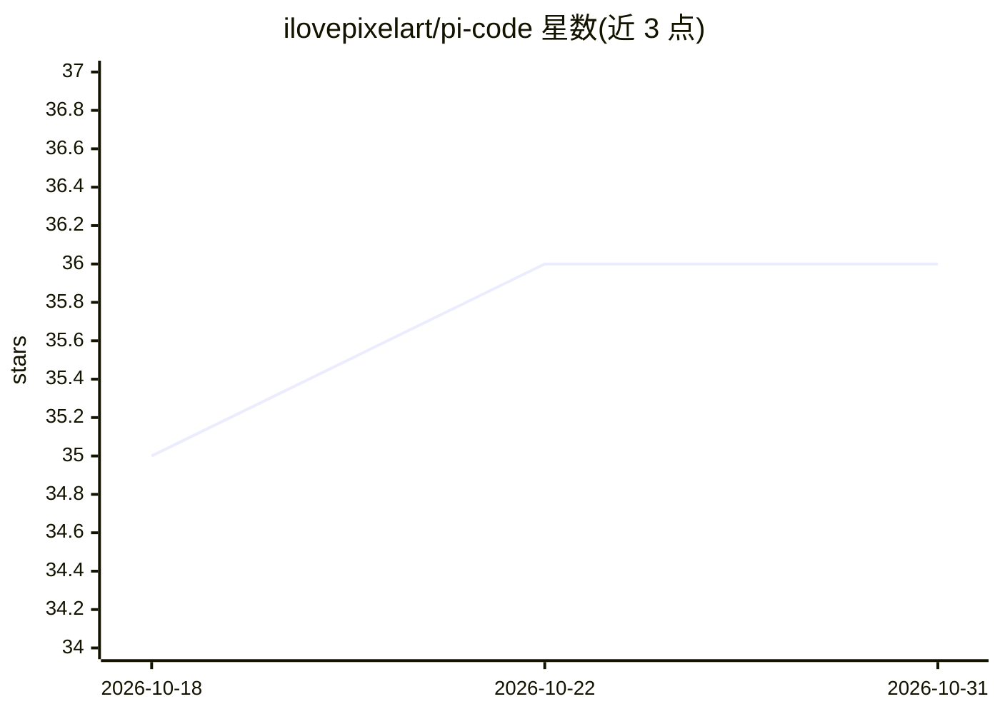

# ilovepixelart/pi-code

⭐ 36 · TypeScript · MIT · 推送 2026-10-30 · [GitHub](https://github.com/ilovepixelart/pi-code) · [官网](https://npmjs.com/package/pi-code) · 个人维护

**为 pi 编码 agent 复用 Claude Code 配置与功能的扩展包**

面向 pi coding agent 的 TypeScript 扩展包：读取项目已有 .claude/ 目录配置（hooks、MCP servers、自定义命令、skills、subagents、CLAUDE.md 规则、输出样式、插件等）并在 pi 中按 Claude Code 的语义加载；同时补充 pi 缺少的功能：todo 叠加层、checkpoints/rewind、持久记忆、无 key 网页搜索、/goal 目标循环与子代理。仓库自带资源默认视为不可信，需用户批准后加载；headless 模式（pi -p）下未决策项目不加载任何资源，策略比 Claude Code 更严格。通过 pi install 从 npm/git/本地安装，需 pi >=0.80.5 与 Node >=22.19，MIT 许可。

## 筛选速览

| 维度 | 判定 | 备注 |
|---|---|---|
| AI 角色 | `ai-ecosystem` | LLM/agent 周边工具 |
| 许可风险 | `permissive` | MIT |
| 部署形态 | `library` | 以包/库形式分发 |
| 模型依赖 | — | README 未给出锁定关系 |
| 硬件要求 | — | 无带数字的原话,不猜 |
| 安装摩擦 | `low` | 无编译、无系统依赖或容器化 |
| 成熟度 | — | 结构信号不足 |

## 能力要点

- 读取 .claude/ 配置（hooks/MCP/命令/skills/agents/规则/插件）并在 pi 中加载
- 补充 todo、checkpoints/rewind、持久记忆、网页搜索、/goal 目标循环、subagents
- 项目自带资源默认不信任，批准后才加载；headless 未决策项目不加载任何资源
- pi install 一次安装全部功能，各功能为独立 extension

## 适用场景

- 在 pi coding agent 中复用已有项目的 Claude Code 配置
- 让 pi 获得 todo、checkpoints、记忆、子代理等 Claude Code 功能
- 在 CI/headless 场景下安全地使用项目内 hooks 与 MCP servers

## 场景标签

`编码 Agent` · 领域:编码与开发

## 证据(README 行号)

> L14: Claude Code experience for the pi coding agent, in one package. Point pi at a project that already has a `.claude/`
> L44: - **Hooks** — your `.claude/settings.json` hooks on every lifecycle event, with Claude's tool vocabulary, decision 

## 星数曲线

2026-10-18 35 → 2026-10-31 36（+1）

---
*卡片 v1 · prompt 1.4 · 生成 2026-10-25 · 置信度 high · 依据 README sha `b7c524dd2829` · [字段定义](../../DATASET.md)*
